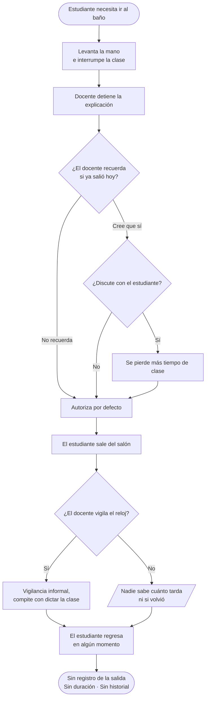
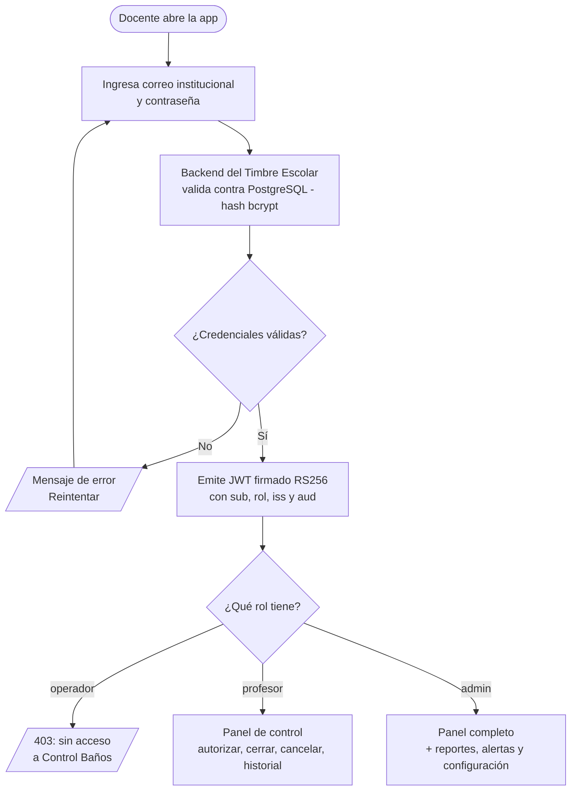
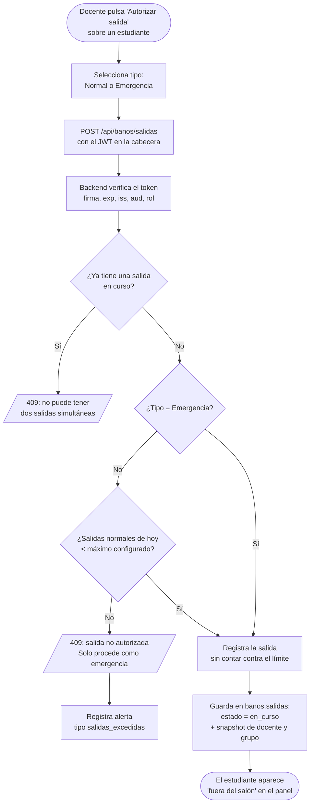
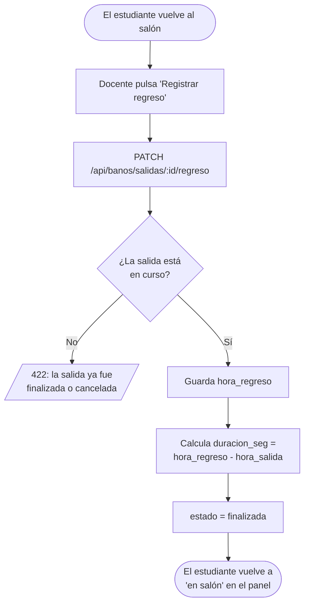
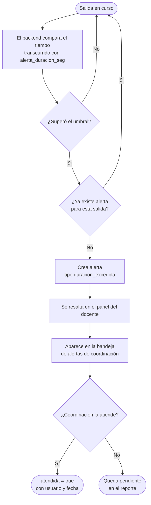
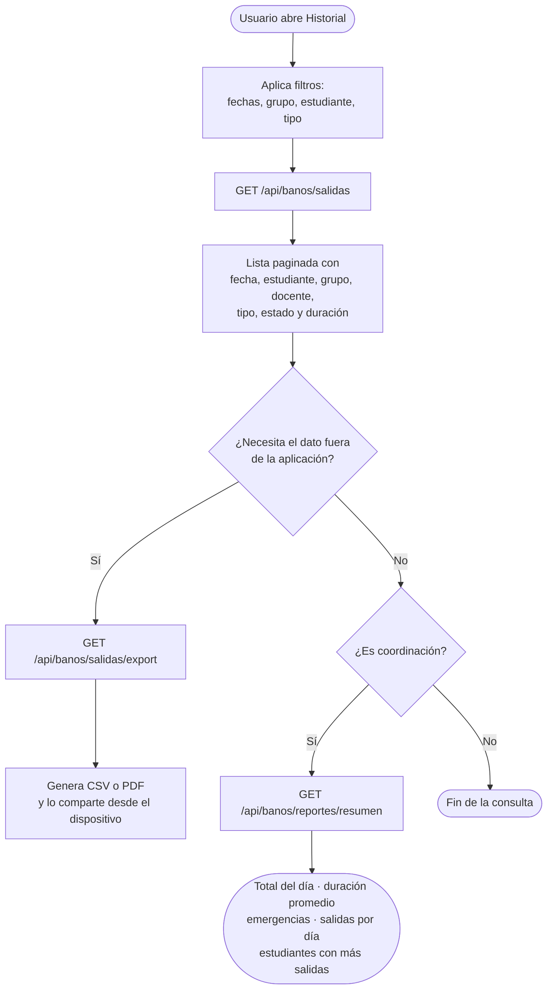
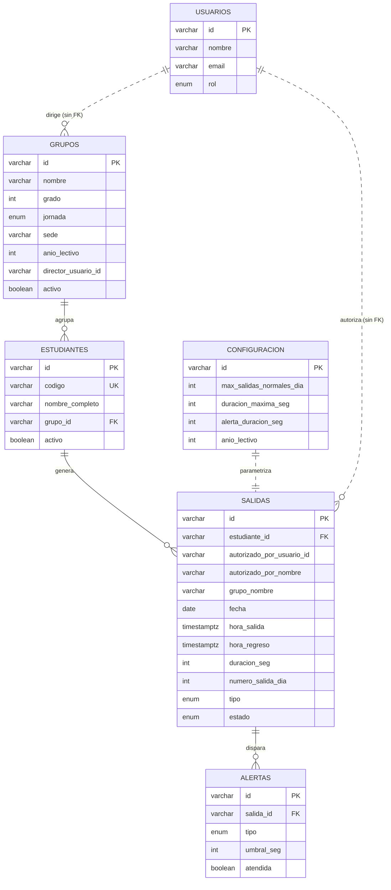

# Control Baños SS — Documento Final

**Análisis, diseño y marca · Versión 1.0 · Julio de 2026**

Proyecto productivo · Técnico en Programación de Software · Articulación con la Media, grado 11
I.E. Santa Sofía — Sede Villa Fanny · Dosquebradas, Risaralda · SENA — CDITI

Jhoan Santiago Chalarca · Isabel Galeano · Juan Esteban Estrada

---

# 1. Análisis y Diseño

## 1.1. Identificación de la empresa

### 1.1.1. El cliente — Institución Educativa Santa Sofía, Sede Villa Fanny

La Institución Educativa Santa Sofía es un colegio público del municipio de Dosquebradas, Risaralda, que atiende estudiantes de básica y media en jornadas de mañana y tarde. La sede Villa Fanny es el escenario del piloto de este proyecto.

Como toda institución de su tamaño, el colegio administra simultáneamente el tiempo de clase, la ubicación de los estudiantes durante la jornada y la convivencia dentro del aula. Las tres cosas dependen hoy de la memoria y la atención del docente, sin ningún soporte digital.

El cliente directo del sistema son los **docentes** de la sede, que son quienes autorizan las salidas. El cliente indirecto es la **coordinación**, que necesita datos agregados para tomar decisiones. El beneficiario final es el **estudiante**, cuya seguridad depende de que la institución sepa dónde está en cada momento de la jornada.

### 1.1.2. El equipo desarrollador

El proyecto lo desarrollan tres aprendices del programa Técnico en Programación de Software, en articulación con la media:

| Integrante | Responsabilidad |
|---|---|
| Jhoan Santiago Chalarca | Líder de proyecto · Backend Vapor y base de datos |
| Isabel Galeano | Diseño UX · Documentación |
| Juan Esteban Estrada | Frontend Flutter · Pruebas |

Control Baños SS forma parte de un proyecto de grado más amplio junto al **Sistema de Timbre Escolar**, desarrollado por otro aprendiz de la misma institución. Ambos sistemas se entregan como módulos de una misma aplicación móvil y comparten la identidad de los usuarios, pero se desarrollan, se versionan y se despliegan por separado.

### 1.1.3. Necesidades en el mercado y alcance de la aplicación

La digitalización del permiso de salida al baño no es un invento local. En Estados Unidos, herramientas como HallPass y e-hallpass son ya infraestructura común en colegios de secundaria, y su adopción se justifica con dos argumentos: reducir interrupciones de clase y saber, en cualquier momento, cuántos estudiantes hay fuera del aula y desde cuándo.

En Colombia ese espacio está prácticamente vacío en el sector público. Los colegios oficiales rara vez pueden pagar licencias por estudiante, que es el modelo de esas plataformas. Control Baños SS aprovecha esa brecha: se construye sobre tecnología libre —Flutter, Vapor y PostgreSQL—, de modo que el costo de licenciamiento sea cero y el sistema pueda replicarse en otra institución sin renegociar contratos.

**Alcance de esta versión:** módulo móvil para docentes y coordinación de la sede Villa Fanny, con panel de control en vivo, autorización y cierre de salidas, historial exportable, alertas de tiempo excedido y reportes agregados.

**Fuera de alcance:** hardware físico (sensores, torniquetes, RFID), notificaciones push o por correo, versión web o de escritorio, acceso de estudiantes o padres, y funcionamiento sin conexión.

---

## 1.2. Problema inicial

En la sede Villa Fanny, cuando un estudiante necesita ir al baño durante una clase, el proceso completo es verbal: levanta la mano, el docente decide, el estudiante sale. En algunos salones se usa un cuaderno de anotaciones; en la mayoría, nada.

De ahí salen cuatro problemas concretos:

**No se sabe quién está fuera.** Si en mitad de la clase alguien pregunta por un estudiante, el docente responde de memoria. Con 35 estudiantes y varias salidas por hora, la memoria falla. En caso de emergencia —un simulacro, un sismo, una evacuación— la institución no tiene forma de saber cuántos estudiantes no están en su aula.

**No se sabe cuánto tardan.** Una salida de tres minutos y una de veinticinco se ven exactamente igual desde el escritorio del docente, que está dictando clase. El tiempo fuera del aula no se mide, así que tampoco se puede corregir.

**No hay historial.** Un estudiante que sale cuatro veces al día, todos los días, es indistinguible de uno que sale una vez a la semana. Puede ser un patrón de evasión, o puede ser un problema de salud que la institución debería atender. Sin registro, ninguna de las dos cosas se detecta.

**Coordinación no tiene datos.** Cualquier decisión sobre convivencia, horarios de descanso o distribución de baños se toma sobre percepciones, no sobre cifras.

El costo acumulado es tiempo de clase. Cada permiso verbal interrumpe la explicación, y cada estudiante que tarda de más es un estudiante que se perdió una parte de la lección.

---

## 1.3. Requerimientos y necesidades

El detalle completo, con criterios de aceptación, está en el *Documento de requerimientos v2.0*. Esta sección resume lo que el sistema debe hacer y bajo qué condiciones.

### 1.3.1. Requerimientos funcionales

**Acceso**

| # | Requerimiento |
|---|---|
| RF01 | El docente inicia sesión con las mismas credenciales institucionales que usa para el resto de la aplicación. El módulo no tiene registro de usuarios ni contraseñas propias. |
| RF02 | El sistema rechaza el acceso al módulo a los usuarios con rol `operador`, con un mensaje claro. |

**Panel de control**

| # | Requerimiento |
|---|---|
| RF03 | El panel "Control Baños" muestra los grupos activos y, dentro de cada uno, sus estudiantes con estado **en salón** o **fuera del salón**. |
| RF04 | El panel muestra la actividad reciente: quién está fuera, hora de salida y tiempo transcurrido, actualizado en vivo. |
| RF05 | Se puede buscar un estudiante por nombre o código dentro del panel. |

**Gestión de salidas**

| # | Requerimiento |
|---|---|
| RF06 | Se autoriza la salida de un estudiante registrando estudiante, docente, fecha y hora. |
| RF07 | Antes de autorizar, el sistema valida cuántas salidas normales lleva el estudiante ese día y bloquea si alcanzó el máximo. |
| RF08 | Si agotó sus salidas normales, el sistema lo informa e indica que solo procede una nueva salida marcándola como **emergencia**. |
| RF09 | Un estudiante no puede tener dos salidas en curso al mismo tiempo. |
| RF10 | Se registra el regreso y se calcula automáticamente la duración. |
| RF11 | Se puede cancelar una salida autorizada, con motivo obligatorio y constancia de quién canceló. |

**Historial y reportes**

| # | Requerimiento |
|---|---|
| RF12 | Historial de salidas con fecha, hora, estudiante, grupo, docente, tipo, estado y duración. |
| RF13 | Filtros por rango de fechas, grupo, estudiante y tipo de salida. |
| RF14 | Exportación del historial filtrado a CSV o PDF, compartible desde el dispositivo. |
| RF15 | Reportes con total de salidas del día, duración promedio, emergencias, salidas por día y estudiantes con más salidas. |

**Alertas y configuración**

| # | Requerimiento |
|---|---|
| RF16 | Alerta automática cuando una salida en curso supera la duración configurada. |
| RF17 | Alerta registrada cuando se intenta autorizar por encima del máximo diario. |
| RF18 | El coordinador consulta las alertas pendientes y las marca como atendidas. |
| RF19 | El coordinador configura máximo de salidas, duración recomendada y umbral de alerta sin recompilar. |

**Administración de datos**

| # | Requerimiento |
|---|---|
| RF20 | Registrar, editar y desactivar grupos y estudiantes. |
| RF21 | Al terminar cualquier acción, se puede volver al panel o registrar una nueva salida sin pasos intermedios. |

### 1.3.2. Requerimientos no funcionales

| # | Atributo | Requerimiento |
|---|---|---|
| RNF01 | Usabilidad | Una instrucción clara por pantalla. Autorizar una salida no toma más de tres toques desde el panel. |
| RNF02 | Rendimiento | Autorizar, cancelar o cerrar una salida se refleja en el panel en menos de 2 segundos. |
| RNF03 | Seguridad | El módulo no almacena contraseñas. Todo acceso exige JWT válido, verificado con la llave pública del Sistema de Timbre Escolar. |
| RNF04 | Aislamiento | El backend solo escribe en su propio schema de base de datos. |
| RNF05 | Disponibilidad | Operativo durante toda la jornada académica, mañana y tarde. |
| RNF06 | Identidad visual | Azul Marino #1E2545, Verde Acción #2D8C3E, Gris Fondo #F2F2F2; Bebas Neue, Inter y Roboto Mono. |
| RNF07 | Compatibilidad | Android 8.0+ e iOS 15+, desde una sola base de código Flutter. |
| RNF08 | Trazabilidad | Toda salida queda registrada de forma permanente, con responsable y marca de tiempo. |
| RNF09 | Mantenibilidad | El módulo vive bajo `lib/modules/proyecto_banos/` y puede eliminarse sin romper la compilación del resto. |
| RNF10 | Privacidad | Los datos de estudiantes solo son visibles para docentes y coordinación autenticados. |

---

## 1.4. Análisis de documentos

### 1.4.1. Manejo actual de la información en la institución

Hoy la información sobre salidas al baño existe en tres soportes, ninguno consultable:

**El permiso verbal.** Es el soporte dominante. No deja rastro: en el momento en que el estudiante sale por la puerta, el único registro es la memoria del docente, y esa memoria se borra en la siguiente hora de clase.

**El cuaderno de anotaciones.** Algunos docentes llevan un cuaderno donde apuntan nombre y hora. Es mejor que nada, pero tiene tres límites: es del docente, no de la institución; no registra el regreso, así que no hay duración; y no es sumable —nadie va a recorrer treinta cuadernos para saber cuántas salidas hubo esta semana.

**La lista de asistencia.** Registra si el estudiante vino al colegio, no dónde está durante la jornada. Un estudiante puede figurar presente y llevar veinte minutos fuera del aula.

De este análisis salen tres conclusiones que orientan el diseño: el registro debe ser **institucional** y no personal del docente; debe capturar **salida y regreso**, porque sin regreso no hay duración y sin duración no hay control; y debe ser **agregable**, porque el valor para coordinación está en la suma, no en el evento individual.

### 1.4.2. Formularios diseñados para la nueva aplicación

Cinco pantallas cubren el flujo completo.

**F-01 · Ingreso**

| Campo | Tipo | Validación |
|---|---|---|
| Correo institucional | Texto | Obligatorio, formato de correo |
| Contraseña | Texto oculto | Obligatorio |

Es la misma pantalla de ingreso de la aplicación institucional. Control Baños no tiene un login propio.

**F-02 · Panel de control**

No es un formulario de captura sino de consulta y acción. Muestra, por grupo: nombre del estudiante, código, estado (en salón / fuera) y, cuando está fuera, hora de salida y tiempo transcurrido. Incluye un campo de búsqueda y un botón de acción por estudiante.

**F-03 · Autorizar salida**

| Campo | Tipo | Validación |
|---|---|---|
| Estudiante | Selección | Obligatorio, viene del panel |
| Tipo de salida | Selección: Normal / Emergencia | Obligatorio, por defecto Normal |
| Motivo | Texto libre | Opcional, máximo 200 caracteres |

Al confirmar, el sistema valida el límite diario. Si está agotado, no guarda: muestra el mensaje de salida no autorizada y ofrece marcarla como emergencia.

**F-04 · Registrar regreso**

| Campo | Tipo | Validación |
|---|---|---|
| Salida | Selección | Obligatorio, viene del panel de salidas en curso |
| Hora de regreso | Fecha y hora | Por defecto la hora actual, editable |

La duración no se captura: se calcula.

**F-05 · Cancelar salida**

| Campo | Tipo | Validación |
|---|---|---|
| Salida | Selección | Obligatorio |
| Motivo de cancelación | Texto libre | **Obligatorio**, mínimo 5 caracteres |

El motivo es obligatorio a propósito: una cancelación sin explicación es indistinguible de un error de digitación, y el historial pierde valor.

---

## 1.5. Procesos y procedimientos (flujogramas — diagramas de procesos)

### 1.5.1. Proceso actual (AS-IS): ¿cómo sale hoy un estudiante al baño?

El estudiante levanta la mano en mitad de la explicación. El docente interrumpe, decide de memoria si ya salió antes, y autoriza o niega. El estudiante sale. Nadie mide cuánto tarda y no queda registro de nada.

### 1.5.2. Procesos con la nueva aplicación (TO-BE)

**P-01 — Ingreso y control de acceso por rol**

**P-02 — Autorizar una salida**

**P-03 — Registrar el regreso y calcular la duración**

**P-04 — Alerta por tiempo excedido**

**P-05 — Consulta, exportación y reportes**

---

## 1.6. Solución del problema

### 1.6.1. Descripción general de la solución

Control Baños SS convierte el permiso verbal en un registro digital de dos tiempos: **salida** y **regreso**. Ese par es todo el sistema; lo demás —límites, alertas, historial, reportes— se deriva de él.

La arquitectura tiene cuatro piezas:

| Pieza | Tecnología | Función |
|---|---|---|
| Aplicación móvil | Flutter (Dart) | Módulo dentro de la app institucional. Panel, autorización, historial y reportes |
| Backend | Vapor 4 (Swift) | API REST propia bajo `/api/banos`. Aplica las reglas de negocio |
| Base de datos | PostgreSQL, schema `banos` | Grupos, estudiantes, salidas, alertas y configuración |
| Identidad | JWT RS256 del Sistema de Timbre Escolar | Un solo login para toda la aplicación institucional |

La decisión de diseño que sostiene todo lo demás es que **el sistema no confía en la memoria de nadie**. El límite de dos salidas diarias no lo recuerda el docente: lo cuenta la base de datos. La duración no la estima nadie: se calcula. El historial no lo lleva un cuaderno: es una tabla que no se borra nunca.

La segunda decisión es la **separación estricta frente al Sistema de Timbre Escolar**. Los dos módulos comparten aplicación, base de datos e identidad de usuarios, pero no comparten ni una tabla escribible ni una línea de código. Control Baños puede eliminarse por completo —su schema y su carpeta— sin que el Sistema de Timbre Escolar deje de compilar ni de funcionar. Las condiciones exactas están en el *Contrato de integración*.

### 1.6.2. Modelo relacional de la base de datos

El modelo tiene **cinco tablas propias** en el schema `banos`, más dos tablas del Sistema de Timbre Escolar que se consultan en solo lectura.

Las relaciones con línea punteada (`..`) hacia `USUARIOS` y desde `CONFIGURACION` **no son llaves foráneas**. Son vínculos lógicos que la aplicación resuelve:

- `USUARIOS` vive en otro schema. No existe FK entre schemas, en ninguna dirección: así el schema `banos` puede eliminarse sin dejar rastro, y una fila de Control Baños nunca bloquea un `DELETE` del Sistema de Timbre Escolar.
- `CONFIGURACION` es una tabla de una sola fila cuyos valores se leen al validar cada salida; no hay columna que la referencie.

Las relaciones con línea continua sí son llaves foráneas reales, todas internas al schema `banos`.

### 1.6.3. Definición y función de cada tabla

| # | Tabla | Función |
|---|---|---|
| 1 | `grupos` | Grupos del colegio (11A, 10B): grado, jornada, sede y año lectivo (RF03, RF20) |
| 2 | `estudiantes` | Estudiantes con su código institucional y el grupo al que pertenecen (RF03, RF20) |
| 3 | `salidas` | Tabla central: cada salida al baño con sus dos tiempos, tipo, estado y responsable (RF06 a RF12) |
| 4 | `alertas` | Alertas generadas por tiempo excedido o intento de salida sobre el límite (RF16 a RF18) |
| 5 | `configuracion` | Parámetros del sistema en fila única: máximo de salidas, duraciones y umbrales (RF19) |

Tablas del Sistema de Timbre Escolar consultadas en **solo lectura**:

| Tabla | Uso |
|---|---|
| `usuarios` | Resolver nombre y rol del docente autenticado |
| `profesores` | Jornada y dirección de grupo del docente |

Tabla que **no se implementa**: `docentes`. El documento de requerimientos v1.0 la modelaba con usuario y contraseña propios, lo que rompía el requisito de login único. Los docentes son filas de `usuarios` con rol `profesor`.

### 1.6.4. Descripción de cada campo por tabla

**Tabla 1 — `grupos`**

| Campo | Tipo | Restricciones | Descripción |
|---|---|---|---|
| `id` | varchar | PK | UUID generado por el backend |
| `nombre` | varchar | NOT NULL, UNIQUE | Identificador del grupo (ej. "11A") |
| `grado` | int | NOT NULL | Grado al que pertenece el grupo, de 6 a 11 |
| `jornada` | jornada_grupo | NOT NULL | mañana, tarde o completa |
| `sede` | varchar | NOT NULL, default `'Villa Fanny'` | Sede de la institución a la que pertenece el grupo |
| `anio_lectivo` | int | NOT NULL, índice `idx_grupos_vigentes` | Año lectivo del grupo (ej. 2026) |
| `director_usuario_id` | varchar | Permite NULL, **sin FK** | `usuarios.id` del director de grupo. Sin FK por vivir en otro schema |
| `activo` | boolean | NOT NULL, default `true` | Permite archivar un grupo sin borrarlo (RF20) |
| `creado_at` | timestamptz | NOT NULL, default `now()` | Fecha de creación del registro |

**Tabla 2 — `estudiantes`**

| Campo | Tipo | Restricciones | Descripción |
|---|---|---|---|
| `id` | varchar | PK | UUID generado por el backend |
| `codigo` | varchar | NOT NULL, UNIQUE | Código institucional del estudiante; sirve para búsqueda (RF05) |
| `nombre_completo` | varchar | NOT NULL | Nombre y apellidos del estudiante |
| `grupo_id` | varchar | NOT NULL, FK → `grupos.id`, índice `idx_estudiantes_grupo` | Grupo al que pertenece |
| `activo` | boolean | NOT NULL, default `true`, índice `idx_estudiantes_activos` | Permite retirar un estudiante sin perder su historial (RF20) |
| `creado_at` | timestamptz | NOT NULL, default `now()` | Fecha de registro |
| `actualizado_at` | timestamptz | NOT NULL, default `now()` | Fecha de la última modificación |

**Tabla 3 — `salidas`**

| Campo | Tipo | Restricciones | Descripción |
|---|---|---|---|
| `id` | varchar | PK | UUID generado por el backend |
| `estudiante_id` | varchar | NOT NULL, FK → `estudiantes.id`, índice `idx_salidas_estudiante_dia` | Estudiante que sale |
| `autorizado_por_usuario_id` | varchar | NOT NULL, **sin FK**, índice `idx_salidas_docente` | `usuarios.id` del docente; se toma del claim `sub` del JWT |
| `autorizado_por_nombre` | varchar | NOT NULL | Copia del nombre del docente al momento de la salida |
| `grupo_nombre` | varchar | NOT NULL | Copia del grupo del estudiante al momento de la salida |
| `fecha` | date | NOT NULL, índice `idx_salidas_fecha` | Día escolar; es la base del conteo del límite diario (RN09) |
| `hora_salida` | timestamptz | NOT NULL | Momento en que el docente autoriza (RF06) |
| `hora_regreso` | timestamptz | Permite NULL | NULL mientras el estado sea `en_curso` (RF10) |
| `duracion_seg` | int | Permite NULL | `hora_regreso − hora_salida`. NULL hasta que el estudiante regrese (RN04) |
| `numero_salida_dia` | int | NOT NULL | Orden de la salida del estudiante ese día: 1, 2, 3… |
| `tipo` | tipo_salida | NOT NULL, default `normal` | `normal` cuenta contra el límite; `emergencia` no (RN02) |
| `estado` | estado_salida | NOT NULL, default `en_curso`, índice `idx_salidas_estado` | `en_curso`, `finalizada` o `cancelada` (RN03) |
| `motivo` | varchar | Permite NULL | Texto libre opcional que escribe el docente |
| `motivo_cancelacion` | varchar | Permite NULL | Obligatorio cuando el estado es `cancelada` (RN07) |
| `cancelado_por_usuario_id` | varchar | Permite NULL, **sin FK** | `usuarios.id` de quien canceló |
| `cancelado_at` | timestamptz | Permite NULL | Momento de la cancelación |
| `creado_at` | timestamptz | NOT NULL, default `now()` | Fecha de creación del registro |

Los campos `autorizado_por_nombre` y `grupo_nombre` son copias deliberadas. Congelan cómo se llamaba el docente y a qué grupo pertenecía el estudiante en el momento exacto de la salida, de modo que el historial siga siendo correcto aunque después el estudiante cambie de grupo o el docente sea dado de baja.

**Tabla 4 — `alertas`**

| Campo | Tipo | Restricciones | Descripción |
|---|---|---|---|
| `id` | varchar | PK | UUID generado por el backend |
| `salida_id` | varchar | NOT NULL, FK → `salidas.id`, índice `idx_alertas_salida` | Salida que originó la alerta |
| `tipo` | tipo_alerta | NOT NULL | `duracion_excedida` o `salidas_excedidas` (RF16, RF17) |
| `umbral_seg` | int | Permite NULL | Valor de configuración vigente cuando se disparó la alerta |
| `generada_at` | timestamptz | NOT NULL, default `now()`, índice `idx_alertas_pendientes` | Momento de generación |
| `atendida` | boolean | NOT NULL, default `false` | Marca de gestión por parte de coordinación (RF18) |
| `atendida_por_usuario_id` | varchar | Permite NULL, **sin FK** | `usuarios.id` de quien atendió |
| `atendida_at` | timestamptz | Permite NULL | Momento en que se atendió |

**Tabla 5 — `configuracion`**

| Campo | Tipo | Restricciones | Descripción |
|---|---|---|---|
| `id` | varchar | PK, default `'config'`, CHECK `id = 'config'` | Fuerza que exista una sola fila |
| `max_salidas_normales_dia` | int | NOT NULL, default `2` | Máximo de salidas normales por estudiante y día (RN01) |
| `duracion_maxima_seg` | int | NOT NULL, default `600` | Duración recomendada de una salida: 10 minutos |
| `alerta_duracion_seg` | int | NOT NULL, default `900` | Umbral que dispara la alerta: 15 minutos (RF16) |
| `permitir_emergencias` | boolean | NOT NULL, default `true` | Permite desactivar las salidas de emergencia si la institución lo decide |
| `anio_lectivo` | int | NOT NULL | Año lectivo vigente |
| `actualizado_at` | timestamptz | NOT NULL, default `now()` | Fecha del último cambio de configuración |

### 1.6.5. Integración con el Sistema de Timbre Escolar

Los dos módulos conviven bajo tres reglas.

**Identidad.** El Sistema de Timbre Escolar es el emisor único de identidad. Firma tokens JWT con RS256 y publica su llave pública en `/.well-known/jwks.json`. Control Baños verifica con esa llave pública, de modo que puede validar tokens pero nunca emitirlos. El algoritmo importa: con HMAC —el que usa hoy el backend del Timbre Escolar— la llave de firma y la de verificación son la misma, y entregarla permitiría a Control Baños emitir un token con rol de administrador.

**Base de datos.** Una sola base PostgreSQL con dos schemas: `public` para el Timbre Escolar y `banos` para Control Baños. El rol `proyectobanos` es dueño de su schema y tiene únicamente `SELECT` sobre `usuarios` y `profesores`. No puede escribir ni crear objetos en `public`; el permiso está revocado en el motor, no confiado a la buena voluntad. Cada backend lleva su propio registro de migraciones de Fluent gracias a que su `search_path` apunta a su schema.

**Código.** El módulo vive completo bajo `lib/modules/proyecto_banos/` y solo puede importar desde `lib/core/`. Se engancha a la aplicación en un único punto —el registro de rutas—, de modo que eliminar la carpeta y esa línea deja la aplicación compilando.

| Regla | Verificación |
|---|---|
| El schema se puede eliminar | `DROP SCHEMA banos CASCADE` no afecta a `public` |
| El módulo se puede eliminar | `rm -rf lib/modules/proyecto_banos/` y `flutter build` sigue pasando |
| No hay escritura cruzada | `INSERT` sobre `public.usuarios` con el rol `proyectobanos` falla con *permission denied* |

---

# 2. Nombre, marca y logo de la aplicación

## 2.1. Nombre de la aplicación: Control Baños SS

### 2.1.1. Construcción y significado

El nombre está formado por dos partes:

**"Control Baños"** — descriptivo y literal. Nombra exactamente lo que el sistema hace, sin metáfora ni juego de palabras. En un entorno escolar, donde el usuario es un docente que abre la aplicación entre dos clases, un nombre transparente vale más que uno ingenioso.

**"SS"** — las iniciales de **Santa Sofía**, la institución para la que se construye. Ancla el producto a su origen y lo diferencia de cualquier herramienta genérica de control de pases.

### 2.1.2. Justificación de la elección

Se descartaron nombres metafóricos del tipo "PassTrack" o "AulaFlow" por dos razones. La primera es de adopción: un docente que ve un ícono nuevo en su teléfono debe saber para qué sirve sin abrirlo. La segunda es de contexto institucional: el sistema será presentado ante coordinación, rectoría y jurados de sustentación, públicos que valoran la claridad sobre el ingenio.

El nombre también soporta el crecimiento. Si el sistema se replica en otra institución, "SS" se sustituye por las iniciales del nuevo colegio sin rehacer la marca.

### 2.1.3. Eslogan (tagline)

> **Cada salida, registrada.**

Tres palabras que resumen la propuesta de valor. "Cada" apunta a la cobertura —ninguna salida queda fuera del sistema—; "registrada" apunta al cambio real frente al proceso actual, que es precisamente la ausencia de registro.

### 2.1.4. Arquitectura de marca

Control Baños SS y el Sistema de Timbre Escolar son **marcas independientes** que conviven en una misma aplicación institucional. No hay relación de submarca entre ellas: cada una tiene su nombre, su paleta y su tipografía, y cada equipo responde por la suya.

Lo único que comparten es la pantalla de ingreso, que pertenece a la aplicación institucional y usa una identidad neutra. A partir del momento en que el usuario entra a un módulo, la identidad visual es la de ese módulo.

---

## 2.2. Personalidad y concepto de marca

El concepto rector es **la constancia sin fricción**: dejar registro de todo sin volver el registro una carga para quien lo hace. Si autorizar una salida en la aplicación toma más tiempo que decir "vaya", el sistema fracasa aunque funcione.

De ahí salen cuatro rasgos de personalidad:

| Rasgo | Qué significa en la práctica |
|---|---|
| **Clara** | Una instrucción por pantalla. Los mensajes de error dicen qué pasó y qué hacer, no un código |
| **Rápida** | Autorizar una salida son tres toques. Todo lo que se pueda calcular no se pregunta |
| **Discreta** | El sistema no juzga al estudiante. Registra hechos: hora, duración, tipo. La interpretación es de la institución |
| **Confiable** | Nada se borra. Una salida cancelada queda en el historial con su motivo |

El tono de la interfaz es el de un colega que ayuda, no el de una autoridad que fiscaliza. Cuando un estudiante agota sus salidas, el mensaje no dice "prohibido": dice que se alcanzó el máximo del día y que la salida procede si se marca como emergencia. La decisión sigue siendo del docente.

---

## 2.3. Identidad visual

### 2.3.1. Paleta de color

| Color | Hex | Uso |
|---|---|---|
| **Azul Marino** | `#1E2545` | Color primario. Encabezados, barras de navegación, fondos de contraste |
| **Verde Acción** | `#2D8C3E` | Color de acción. Botones de autorizar, estados correctos, acentos |
| **Gris Fondo** | `#F2F2F2` | Fondos de tarjetas, filas alternas de tablas, superficies neutras |
| **Blanco** | `#FFFFFF` | Fondo principal de las pantallas |

El azul marino aporta la seriedad institucional que el contexto exige; el verde marca las acciones que hacen avanzar el flujo. La regla de uso es estricta: **el verde solo se usa para acciones y estados positivos**. Nunca para decoración. Así, en cualquier pantalla, lo verde es lo que se puede tocar.

Colores de estado derivados, usados solo en indicadores:

| Estado | Color | Significado |
|---|---|---|
| En salón | `#2D8C3E` | El estudiante está en el aula |
| Fuera del salón | `#C8611E` | Salida en curso dentro del tiempo normal |
| Tiempo excedido | `#B3261E` | Salida en curso que superó el umbral de alerta |
| Cancelada | `#6B7189` | Registro histórico sin efecto |

### 2.3.2. Tipografía

| Familia | Uso | Justificación |
|---|---|---|
| **Bebas Neue** | Títulos y encabezados | Condensada y de alto impacto; rinde bien en pantallas pequeñas donde el espacio horizontal es escaso |
| **Inter** | Cuerpo de texto e interfaz | Diseñada para pantalla, con excelente legibilidad en tamaños pequeños y buen soporte de acentos y ñ |
| **Roboto Mono** | Datos, códigos y horas | El ancho fijo alinea verticalmente horas y duraciones en las tablas de historial, que es donde más se leen |

La elección de una monoespaciada para los datos no es estética: en el historial, la columna de duración se lee de arriba abajo comparando cifras, y una fuente proporcional desalinea los dígitos.

### 2.3.3. Logo

El logotipo es una **marca tipográfica** construida sobre Bebas Neue, sin ilustración. La razón es práctica: un ícono de inodoro o de puerta sería literal hasta lo incómodo en un entorno escolar, y cualquier metáfora más abstracta necesitaría explicación.

**Isotipo.** Las iniciales **CB** en Bebas Neue blanco sobre un cuadrado de esquinas redondeadas en Azul Marino, con un punto en Verde Acción a la derecha de la B. El punto es el elemento distintivo del sistema: marca el registro, el acto de dejar constancia.

**Logotipo horizontal.** "CONTROL BAÑOS" en Bebas Neue Azul Marino, con el punto verde antes de "SS". Se usa en documentos, encabezados y presentaciones.

**Versiones.** Positivo sobre fondo claro (azul marino sobre blanco), negativo sobre fondo oscuro (blanco sobre azul marino) y monocromo para impresión en una tinta.

**Zona de protección.** Un margen libre equivalente a la altura de la letra "C" en todos los lados. Sobre fotografías el isotipo se usa siempre dentro de su cuadrado sólido, nunca calado.

---

*Control Baños SS · Documento Final · Versión 1.0 · Julio de 2026*
*Jhoan Santiago Chalarca · Isabel Galeano · Juan Esteban Estrada*
*I.E. Santa Sofía — Sede Villa Fanny, Dosquebradas (Risaralda) · SENA — CDITI*
