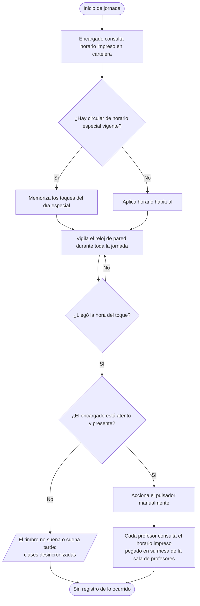
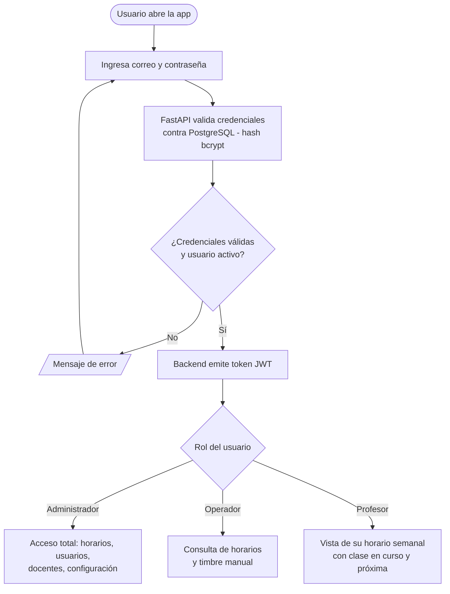
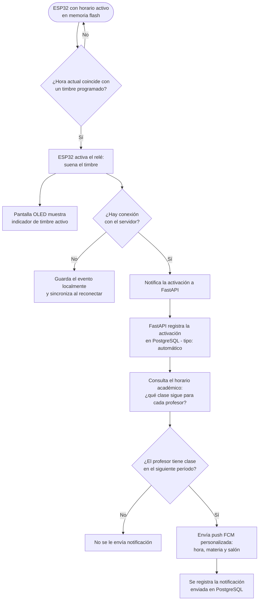
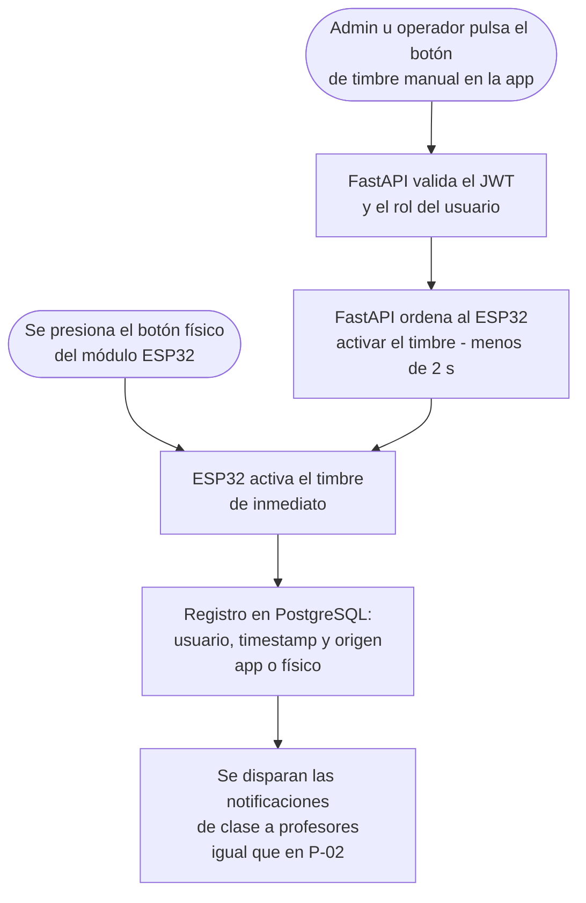
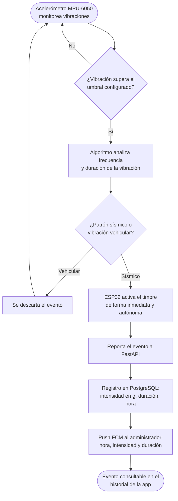
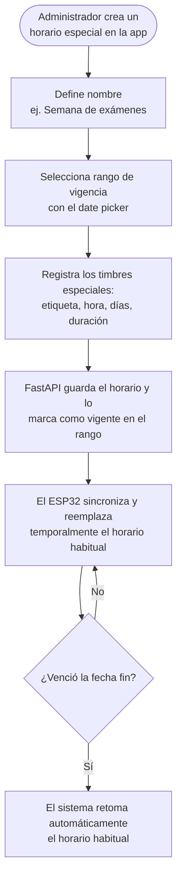
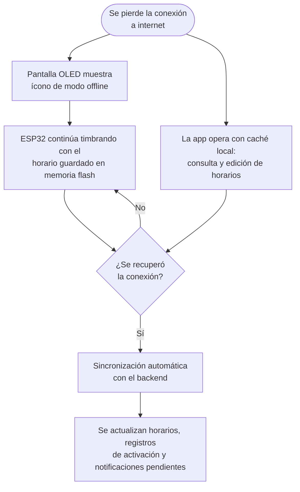
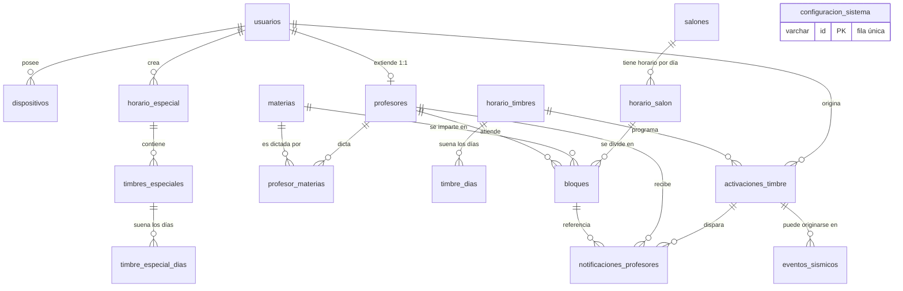

**PROYECTO FINAL**

**Documentación del proyecto**

Este documento tiene como propósito general determinar la norma básica para la entrega de la documentación requerida para el proyecto de base de datos para la web:

---

# 1. Análisis y Diseño

## 1.1. Identificación de la empresa

### 1.1.1. El cliente — Institución Educativa Santa Sofía

| Campo | Detalle |
|---|---|
| Nombre | Institución Educativa Santa Sofía |
| Ubicación | Dosquebradas, Risaralda — Colombia |
| Sector | Educación |
| Contacto / Administradora del sistema | Doña Andrea |
| Proyecto contratado | Sistema de Timbre Escolar Inteligente |
| Desarrollado por | Swifty Devs |

La Institución Educativa Santa Sofía es un colegio ubicado en el municipio de Dosquebradas (Risaralda, Colombia), conformado por varias sedes, que atiende estudiantes en jornadas de mañana y tarde, **de lunes a viernes**. (Aunque la operación regular es de lunes a viernes, los requerimientos y el modelo de datos contemplan días activos de lunes a sábado, lo que permite programar timbres los sábados para jornadas extraordinarias como recuperaciones o actividades institucionales.) Como toda institución educativa, su operación diaria está regulada por el timbre escolar: es el timbre el que marca el inicio de la jornada, los cambios de clase, los descansos y la salida. Adicionalmente, la institución cuenta con una planta docente organizada por materias, salones y bloques de clase, cuya rotación diaria también depende de la puntualidad del timbre.

Un factor determinante del contexto es la ubicación geográfica: Dosquebradas pertenece al Eje Cafetero, una zona de amenaza sísmica alta en Colombia. Por ello, la institución requiere no solo automatizar el timbre, sino contar con un mecanismo de alerta temprana que active la señal de evacuación ante un evento sísmico.

### 1.1.2. El equipo desarrollador — Swifty Devs

Swifty Devs es un estudio de desarrollo de software fundado en 2026, con la filosofía de "apps hechas con intención": un estudio pequeño con estándares de clase mundial, donde cada producto que se publica es intencional, cuidado y nativo. Sus valores de marca son el **cuidado** (cada pixel es una decisión), la **confianza** (el diseño como primera señal de seriedad) y la **artesanía** (cada release es un acto de orgullo, no solo de entrega).

Aunque el enfoque principal del estudio es el ecosistema Apple (iOS, macOS, Swift), su público objetivo incluye **empresas y organizaciones que necesitan software a medida**. Este proyecto pertenece a esa línea de negocio: para garantizar cobertura tanto en Android como en iOS —realidad de los dispositivos del personal del colegio—, la solución se construye con Flutter en el frontend móvil, FastAPI + PostgreSQL en el backend y un módulo físico basado en ESP32, manteniendo el estándar de calidad visual y técnica que caracteriza al estudio (Material Design 3, arquitectura limpia, comunicación segura).

### 1.1.3. Necesidades en el mercado y alcance de la aplicación

**Necesidad en el mercado.** En Colombia, la gran mayoría de instituciones educativas oficiales gestionan su timbre de forma manual (una persona acciona un pulsador o campana según el reloj) o con temporizadores autónomos que no se pueden administrar remotamente, no contemplan horarios especiales, no notifican a los docentes y no ofrecen ningún protocolo ante sismos. No existe en el mercado local una solución integrada, económica y administrable desde el celular que resuelva estos cuatro frentes a la vez.

**Alcance de la aplicación.** El sistema a desarrollar comprende:

- **Aplicación móvil Flutter** (Android 8.0+ / iOS 14+) con tres roles: Administrador, Operador y Profesor.
- **Backend propio FastAPI + PostgreSQL** (AlmaLinux, autenticación JWT), lo que garantiza control total sobre los datos e independencia de plataformas externas. Swifty Devs ofrece dos modalidades de despliegue a elección del cliente: **(a)** alojamiento en los servidores propios de Swifty Devs (dominio `host.swiftydevs.dev`) con un costo mensual por definir, o **(b)** entrega del código fuente del backend para que la institución lo aloje en su propia infraestructura, en caso de no requerir el servicio de alojamiento.
- **Módulo físico ESP32** que acciona el timbre (relé de estado sólido), opera de forma autónoma sin internet, incluye pantalla OLED informativa y un acelerómetro MPU-6050 para detección de sismos.
- **Notificaciones push** a los docentes mediante FCM (usado exclusivamente como canal de entrega).

El alcance de esta implementación cubre **todas las sedes de la I.E. Santa Sofía** (cada sede contará con su propio módulo físico de timbre, administradas desde la misma plataforma). Adicionalmente, la arquitectura de backend propio y el modelo de datos parametrizable (tabla de configuración, catálogos de salones y materias) permiten escalar la solución a otras instituciones educativas de la región como producto replicable.

**Fuera del alcance de la versión 1.** La app no incluye en su primera versión un mecanismo de notificación de cambios puntuales de asignación durante la jornada (por ejemplo: "el profesor tenía clase en 10D —o tenía la hora libre— y debe dirigirse al salón 11B a acompañar o adelantar clase"). Las notificaciones de la v1 se basan exclusivamente en el horario semanal registrado. Esta funcionalidad queda identificada como una posibilidad de mejora para versiones futuras.

## 1.2. Problema inicial

Actualmente el timbre de la I.E. Santa Sofía se opera de forma **completamente manual**: una persona (coordinación / portería) debe estar pendiente del reloj durante toda la jornada y accionar el pulsador del timbre en cada cambio de clase, descanso, entrada y salida. Esta operación presenta las siguientes deficiencias:

1. **Dependencia de una persona.** Si el encargado se distrae, se ausenta o llega tarde, el timbre no suena o suena a destiempo, y toda la institución pierde sincronía en sus clases.
2. **Errores de puntualidad recurrentes.** Los toques manuales varían minutos arriba o abajo, lo que acorta o alarga clases y descansos de manera arbitraria.
3. **Horarios especiales difíciles de coordinar.** Jornadas de exámenes, actos cívicos o reuniones exigen "recordar" un horario distinto durante días específicos, lo que multiplica los errores y exige coordinación verbal constante.
4. **Los docentes no reciben información.** El timbre suena, pero ningún profesor es informado de cuál es su siguiente clase ni a qué salón debe dirigirse; esa consulta se hace en el pequeño horario impreso que se entrega a cada docente, que generalmente pega en su mesa de la sala de profesores.
5. **No existe registro histórico.** No queda constancia de cuándo sonó el timbre, quién lo activó ni por qué, lo que impide auditar la operación.
6. **No hay protocolo automático ante sismos.** Estando en zona de amenaza sísmica alta, la institución no cuenta con ningún mecanismo que detecte un sismo y active automáticamente la señal de evacuación; la reacción depende por completo del criterio humano en un momento de pánico.
7. **Vulnerabilidad ante fallas de conectividad.** Cualquier solución que dependa exclusivamente de internet dejaría al colegio sin timbre ante un corte del servicio, algo frecuente en la zona.

**Formulación del problema:** la I.E. Santa Sofía necesita un sistema que automatice la operación del timbre escolar según horarios configurables, permita activaciones manuales controladas, notifique a cada docente su próxima clase, detecte eventos sísmicos activando la alarma de forma autónoma, funcione aun sin conexión a internet y deje registro auditable de toda su operación.

## 1.3. Requerimientos y necesidades

El levantamiento de requerimientos se consolidó en el documento *Requerimientos_TimbreEscolar_SwiftyDevs* (versión 3.0, junio de 2026), del cual se transcriben a continuación los requerimientos funcionales (RF) y no funcionales (RNF) acordados con el cliente.

### 1.3.1. Requerimientos funcionales

**Módulo 1 — Gestión de usuarios y autenticación**

| ID | Requerimiento |
|---|---|
| RF-01 | El sistema contará con autenticación propia mediante JWT (JSON Web Tokens) gestionada desde el backend FastAPI. |
| RF-02 | Existirá una cuenta de Administrador Principal (Doña Andrea) creada en la inicialización del sistema, no eliminable. |
| RF-03 | El administrador principal podrá crear, editar, suspender y eliminar usuarios secundarios. |
| RF-04 | El sistema manejará tres roles: Administrador, Operador y Profesor. |
| RF-05 | Los operadores podrán consultar horarios y activar el timbre manual, pero no modificar horarios ni gestionar usuarios. |
| RF-06 | El administrador podrá asignar y revocar permisos individuales por usuario. |

**Módulo 2 — Horarios**

| ID | Requerimiento |
|---|---|
| RF-07 | El sistema permitirá definir un horario habitual semanal con múltiples timbres por día. |
| RF-08 | Cada timbre tendrá: hora, días activos (L-S), etiqueta descriptiva (ej. "Inicio de clases") y duración del sonido. |
| RF-09 | El administrador podrá crear, editar y eliminar timbres del horario habitual. |
| RF-10 | El sistema soportará horarios especiales que suspenden temporalmente el horario habitual. |
| RF-11 | Al activar un horario especial, se habilitará un date picker para definir el rango de días de vigencia. |
| RF-12 | Al vencer el rango del horario especial, el sistema retomará automáticamente el horario habitual. |
| RF-13 | Solo el administrador podrá activar, modificar y desactivar horarios especiales. |

**Módulo 3 — Timbre manual**

| ID | Requerimiento |
|---|---|
| RF-14 | La app contará con un botón de timbre manual visible en la pantalla principal. |
| RF-15 | El módulo ESP32 contará con un botón físico de timbre manual. |
| RF-16 | Ambos botones ejecutarán el timbre de forma inmediata, independientemente del horario activo. |
| RF-17 | Cada activación manual quedará registrada en PostgreSQL con usuario, timestamp y origen (app / físico). |

**Módulo 4 — Detección de sismos**

| ID | Requerimiento |
|---|---|
| RF-18 | El ESP32 contará con un acelerómetro (MPU-6050) para detección de vibraciones sísmicas. |
| RF-19 | El algoritmo de detección deberá distinguir entre sismos y vibraciones de vehículos, usando análisis de frecuencia y duración de la vibración. |
| RF-20 | Un evento sísmico confirmado enviará una notificación push FCM al dispositivo del administrador. |
| RF-21 | La notificación incluirá: hora del evento, intensidad estimada (en g) y duración de la vibración. |
| RF-22 | Al confirmarse un evento sísmico, el módulo ESP32 activará el timbre de forma inmediata y autónoma. Simultáneamente FastAPI enviará la notificación push al administrador como registro del evento. |
| RF-23 | El historial de eventos sísmicos detectados será consultable desde la app. |

**Módulo 5 — Pantalla OLED en módulo físico**

| ID | Requerimiento |
|---|---|
| RF-24 | El módulo incluirá una pantalla OLED de 1.3" (SH1106). |
| RF-25 | La pantalla mostrará en tiempo real: hora actual, nombre del próximo timbre y tiempo restante. |
| RF-26 | Al activarse el timbre, la pantalla mostrará un indicador visual de timbre activo. |
| RF-27 | Si no hay conexión a internet, la pantalla indicará el modo offline con un ícono visible. |

**Módulo 6 — Operación offline**

| ID | Requerimiento |
|---|---|
| RF-28 | El ESP32 almacenará localmente el horario activo en memoria flash (SPIFFS / LittleFS). |
| RF-29 | La app Flutter utilizará caché local para permitir consulta y edición de horarios sin conexión. |
| RF-30 | Los cambios realizados offline se sincronizarán automáticamente con el backend al recuperar conectividad. |
| RF-31 | El módulo ESP32 operará el timbre automático de forma autónoma aunque pierda conexión al servidor. |

**Módulo 7 — Profesores y notificaciones de clase**

| ID | Requerimiento |
|---|---|
| RF-32 | Cada profesor tendrá un perfil en el sistema con: nombre, correo, materia(s) que dicta y token FCM de su dispositivo. |
| RF-33 | El administrador podrá crear, editar y eliminar perfiles de profesores desde la app. |
| RF-34 | Cada profesor tendrá un horario semanal asignado con entradas que incluyen: día, hora de inicio, hora de fin, materia y salón. |
| RF-35 | El administrador podrá cargar y modificar el horario semanal de cada profesor desde la app. |
| RF-36 | Al activarse el timbre (automático, manual o sísmico), FastAPI consultará qué clase corresponde a continuación para cada profesor según su horario en PostgreSQL. |
| RF-37 | Se enviará una notificación push FCM personalizada a cada profesor con: hora de la próxima clase, materia y salón al que debe dirigirse. |
| RF-38 | Si un profesor no tiene clase en el siguiente período, no recibirá notificación. |
| RF-39 | Los profesores tendrán acceso a la app con rol Profesor, diferente al Administrador y al Operador. |
| RF-40 | La app en modo Profesor mostrará el horario semanal completo del profesor autenticado. |
| RF-41 | La clase en curso se resaltará visualmente con un indicador de color y etiqueta "En curso". |
| RF-42 | La próxima clase se resaltará con un indicador secundario y etiqueta "Próxima". |
| RF-43 | El horario del profesor se actualizará en tiempo real si el administrador realiza cambios durante el día. |

### 1.3.2. Requerimientos no funcionales

| ID | Requerimiento |
|---|---|
| RNF-01 | La app usará los colores institucionales del colegio como paleta principal. |
| RNF-02 | La interfaz seguirá los lineamientos de Material Design 3. |
| RNF-03 | La app debe ser compatible con Android 8.0+ e iOS 14+. |
| RNF-04 | El tiempo de respuesta entre comando de la app y activación del timbre físico no debe superar 2 segundos con conexión estable. |
| RNF-05 | El envío de notificaciones FCM a todos los profesores debe completarse en menos de 5 segundos desde la activación del timbre. |
| RNF-06 | Toda comunicación entre la app y el backend usará HTTPS con certificado SSL válido. |
| RNF-07 | Las contraseñas se almacenarán en PostgreSQL con hash bcrypt. Nunca en texto plano. |
| RNF-08 | La autenticación se realizará mediante JWT con tiempo de expiración configurable. |
| RNF-09 | El código Flutter seguirá arquitectura Clean Architecture con separación por capas (data / domain / presentation). |

## 1.4. Análisis de documentos

### 1.4.1. Manejo actual de la información en la institución

Durante el levantamiento de información con el cliente se identificó que toda la información asociada a la operación del timbre y los horarios se maneja en medios físicos e informales:

| Información | Cómo se registra hoy | Cómo se consulta | Cómo se almacena | Problema identificado |
|---|---|---|---|---|
| Horario de timbres de la jornada | Hoja impresa / cartelera en coordinación | Lectura visual del encargado, contrastando con el reloj | Papel en cartelera; se reimprime cuando cambia | Se desactualiza, no genera alertas, depende de la memoria del encargado |
| Horarios especiales (exámenes, actos cívicos) | Circular impresa o mensaje verbal / grupo de chat | Cada quien consulta la circular o pregunta | Papel o mensajes dispersos | No hay una única fuente de verdad; los errores de toque se multiplican |
| Horario académico de docentes (materia, salón, bloque) | Cuadro de asignación elaborado en hoja de cálculo e impreso | Pequeño horario impreso que se entrega a cada docente, quien generalmente lo pega en su mesa de la sala de profesores | Papel pegado en la mesa + archivo de hoja de cálculo sin control de versiones | El docente no recibe recordatorios; los cambios de última hora se comunican verbalmente |
| Activaciones del timbre | No se registra | No es posible consultar | No existe | Cero trazabilidad: no se sabe cuándo, quién ni por qué sonó |
| Eventos sísmicos / emergencias | No se registra; reacción improvisada | No aplica | No existe | Sin protocolo automático ni historial del evento |
| Personal autorizado para operar el timbre | Acuerdo verbal | Conocimiento informal | No existe | Cualquiera con acceso físico puede accionarlo, sin control ni registro |

**Conclusión del análisis:** la institución no posee documentos estructurados ni sistemas de información para estos procesos; la información vive en papel, carteleras y acuerdos verbales. Por lo tanto, corresponde al equipo desarrollador **diseñar los formularios digitales** que soportarán el registro, consulta y actualización de la información en la nueva aplicación.

### 1.4.2. Formularios diseñados para la nueva aplicación

Los formularios fueron prototipados como wireframes de alta fidelidad (carpeta `stitch_requirement_based_app_wireframes/` de este repositorio de documentación). Cada formulario, sus campos y su propósito:

**F-01 — Bienvenida e inicio de sesión** *(wireframe: `bienvenida_y_login_yellow`)*

| Campo | Tipo de dato | Obligatorio |
|---|---|---|
| Correo electrónico | Texto (email) | Sí |
| Contraseña | Texto (oculto) | Sí |

Propósito: autenticar al usuario contra el backend (JWT) y dirigirlo a la interfaz correspondiente a su rol (RF-01, RF-04).

**F-02 — Control de timbres (pantalla principal)** *(wireframe: `control_de_timbres_yellow`)*

| Campo / Elemento | Tipo de dato | Descripción |
|---|---|---|
| Botón de timbre manual | Acción | Activa el timbre de inmediato (RF-14, RF-16) |
| Próximo timbre | Solo lectura | Etiqueta y hora del siguiente toque programado |
| Lista de timbres del día | Solo lectura | Timbres del horario vigente (habitual o especial) |

**F-03 — Crear o editar timbre** *(wireframe: `crear_o_editar_timbre_yellow`)*

| Campo | Tipo de dato | Obligatorio |
|---|---|---|
| Etiqueta descriptiva | Texto (ej. "Inicio de clases") | Sí |
| Hora | Hora (time picker) | Sí |
| Días activos | Selección múltiple L-S | Sí |
| Duración del sonido | Número (segundos) | Sí (por defecto 5) |

Propósito: registrar y mantener los timbres del horario habitual (RF-07 a RF-09).

**F-04 — Timbres especiales** *(wireframe: `timbres_especiales_yellow`)*

| Campo | Tipo de dato | Obligatorio |
|---|---|---|
| Nombre del horario especial | Texto (ej. "Semana de exámenes") | Sí |
| Rango de vigencia | Fechas inicio–fin (date picker) | Sí |
| Timbres del horario especial | Lista (etiqueta, hora, días, duración) | Sí |

Propósito: crear horarios que suspenden temporalmente el habitual y expiran solos (RF-10 a RF-13). Acceso exclusivo del administrador.

**F-05 — Gestión de docentes** *(wireframe: `gesti_n_de_docentes_yellow`)*

| Campo | Tipo de dato | Obligatorio |
|---|---|---|
| Nombre completo | Texto | Sí |
| Correo electrónico | Texto (email) | Sí |
| Materia(s) que dicta | Selección múltiple del catálogo | Sí |
| Jornada | Selección (mañana / tarde / completa) | Sí |
| Director de grupo | Texto (ej. "11B") | No |

Propósito: administrar los perfiles de profesores y sus datos de notificación (RF-32, RF-33).

**F-06 — Asignación horaria** *(wireframe: `asignaci_n_horaria_yellow`)*

| Campo | Tipo de dato | Obligatorio |
|---|---|---|
| Salón | Selección del catálogo | Sí |
| Día de la semana | Selección L-S | Sí |
| Bloques de clase | Lista ordenada: n.º, hora inicio, hora fin, materia, profesor | Sí |

Propósito: construir el horario académico por salón, base de las notificaciones de clase a los docentes (RF-34 a RF-36).

**F-07 — Configuración del sistema** *(wireframe: `configuraci_n_yellow`)*

| Campo | Tipo de dato | Obligatorio |
|---|---|---|
| Nombre del colegio | Texto | No |
| Umbral sísmico (g) | Número decimal | Sí (por defecto 1.2) |
| Duración mínima de sismo (ms) | Número entero | Sí (por defecto 800) |
| Gestión de usuarios (crear / suspender / eliminar) | Sub-formulario | — |

Propósito: parametrizar el sistema y administrar cuentas (RF-02, RF-03, RF-06, RF-19).

**F-08 — Historial de notificaciones y activaciones** *(wireframe: `historial_de_notificaciones_yellow`)*

| Campo / Elemento | Tipo de dato | Descripción |
|---|---|---|
| Filtro por fecha | Rango de fechas | Acota la consulta |
| Lista de activaciones | Solo lectura | Tipo (automático / manual app / manual físico / sísmico), usuario, fecha y hora (RF-17) |
| Lista de eventos sísmicos | Solo lectura | Intensidad (g), duración, fecha y hora (RF-23) |

**F-09 — Vista del profesor** *(wireframe: `vista_profesor_yellow`)*

| Campo / Elemento | Tipo de dato | Descripción |
|---|---|---|
| Horario semanal completo | Solo lectura | Bloques del profesor autenticado (RF-40) |
| Indicador "En curso" | Visual | Resalta la clase actual (RF-41) |
| Indicador "Próxima" | Visual | Resalta la siguiente clase (RF-42) |

## 1.5. Procesos y procedimientos (flujogramas — diagramas de procesos)

### 1.5.1. Proceso actual (AS-IS): ¿cómo suena hoy un cambio de clase?

El encargado en coordinación consulta la hoja impresa del horario, vigila el reloj de pared y, cuando considera que llegó la hora, acciona el pulsador del timbre. Si hay horario especial, debe recordarlo o consultar la circular. No queda ningún registro de la operación.

### 1.5.2. Procesos con la nueva aplicación (TO-BE)

**P-01 — Inicio de sesión y control de acceso por rol**

**P-02 — Timbre automático y notificación a profesores**

**P-03 — Timbre manual (desde la app o el botón físico)**

**P-04 — Detección de evento sísmico**

**P-05 — Activación de un horario especial**

**P-06 — Operación y sincronización offline**

## 1.6. Solución del problema

### 1.6.1. Descripción general de la solución

La solución es el **Sistema de Timbre Escolar Inteligente**: una plataforma compuesta por cuatro componentes que, en conjunto, cubren todas las necesidades identificadas en 1.2 y los requerimientos de 1.3:

| Componente | Rol en la solución |
|---|---|
| **App Flutter** (Admin / Operador / Profesor) | Interfaz de gestión: horarios, usuarios, docentes, timbre manual, historiales y vista del profesor |
| **Backend FastAPI** (AlmaLinux, HTTPS) | Lógica de negocio, autenticación JWT, API REST y despacho de notificaciones |
| **Base de datos PostgreSQL** | Almacenamiento relacional con integridad referencial de toda la información del sistema |
| **Módulo físico ESP32** | Acciona el timbre (automático, manual y sísmico), opera offline, pantalla OLED y sensor sísmico MPU-6050 |

Las notificaciones push se entregan mediante FCM únicamente como canal de entrega; no existe ninguna otra dependencia de Firebase, garantizando control total sobre los datos.

### 1.6.2. Modelo relacional de la base de datos

El modelo de datos (versión 5, archivo fuente `SketchBD.dbml`) consta de **17 tablas** y **5 tipos enumerados** sobre PostgreSQL.

**Diagrama entidad–relación**

**Tipos enumerados (ENUM)**

| Enum | Valores | Uso |
|---|---|---|
| `rol_usuario` | `admin`, `operador`, `profesor` | Rol de cada cuenta (RF-04) |
| `tipo_activacion` | `automatico`, `manual_app`, `manual_fisico`, `sismico` | Origen de cada activación del timbre (RF-17) |
| `dia_semana` | `lunes`, `martes`, `miercoles`, `jueves`, `viernes`, `sabado` | Días de la semana soportados por el sistema (RF-08); la operación regular del colegio es de lunes a viernes |
| `plataforma` | `ios`, `android`, `web` | Plataforma del dispositivo registrado para push (web incluye Windows vía PWA / FCM Web Push) |
| `jornada` | `manana`, `tarde`, `completa` | Jornada laboral del profesor |

### 1.6.3. Definición y función de cada tabla

| # | Tabla | Función |
|---|---|---|
| 1 | `usuarios` | Cuentas de acceso al sistema con su rol y credenciales (RF-01 a RF-06) |
| 2 | `dispositivos` | Dispositivos (celular, tablet, navegador) de cada usuario y su token FCM; el push se envía a todos los dispositivos activos del usuario |
| 3 | `profesores` | Extensión 1:1 del usuario con rol profesor: jornada y dirección de grupo (RF-32) |
| 4 | `materias` | Catálogo de materias de la institución |
| 5 | `profesor_materias` | Relación muchos-a-muchos entre profesores y las materias que dictan (RF-32) |
| 6 | `salones` | Catálogo de salones físicos del colegio |
| 7 | `horario_timbres` | Timbres del horario habitual semanal (RF-07 a RF-09) |
| 8 | `timbre_dias` | Días de la semana en que suena cada timbre habitual (RF-08) |
| 9 | `horario_especial` | Cabecera de los horarios especiales con su rango de vigencia (RF-10 a RF-13) |
| 10 | `timbres_especiales` | Timbres que componen cada horario especial |
| 11 | `timbre_especial_dias` | Días de la semana en que suena cada timbre especial |
| 12 | `horario_salon` | Cabecera del horario académico de un salón para un día de la semana |
| 13 | `bloques` | Bloques de clase de cada horario de salón: orden, horas, materia y profesor (RF-34) |
| 14 | `activaciones_timbre` | Bitácora de cada vez que suena el timbre: tipo, origen, usuario y timestamp (RF-17) |
| 15 | `eventos_sismicos` | Historial de eventos sísmicos detectados por el módulo (RF-18 a RF-23) |
| 16 | `notificaciones_profesores` | Notificaciones push de próxima clase enviadas a cada profesor (RF-36 a RF-38) |
| 17 | `configuracion_sistema` | Parámetros globales del sistema en fila única (umbral sísmico, modo offline, etc.) |

### 1.6.4. Descripción de cada campo por tabla

**Tabla 1 — `usuarios`**

| Campo | Tipo | Restricciones | Descripción |
|---|---|---|---|
| `id` | varchar | PK | UUID generado por el backend |
| `nombre` | varchar | NOT NULL | Nombre completo del usuario |
| `email` | varchar | NOT NULL, UNIQUE | Correo electrónico; usado como credencial de inicio de sesión |
| `password_hash` | varchar | NOT NULL | Contraseña con hash bcrypt; nunca en texto plano (RNF-07) |
| `rol` | rol_usuario | NOT NULL | Rol de la cuenta: admin, operador o profesor (RF-04) |
| `activo` | boolean | NOT NULL, default `true` | Permite suspender la cuenta sin eliminarla (RF-03) |
| `creado_at` | timestamptz | NOT NULL, default `now()` | Fecha y hora de creación de la cuenta |
| `actualizado_at` | timestamptz | NOT NULL, default `now()` | Fecha y hora de la última modificación |

**Tabla 2 — `dispositivos`**

| Campo | Tipo | Restricciones | Descripción |
|---|---|---|---|
| `id` | varchar | PK | Identificador del dispositivo |
| `usuario_id` | varchar | NOT NULL, FK → `usuarios.id`, índice `idx_disp_usuario` | Usuario propietario del dispositivo |
| `plataforma` | plataforma | NOT NULL | ios, android o web |
| `fcm_token` | varchar | NOT NULL, UNIQUE | Token FCM del dispositivo, destino de las notificaciones push |
| `nombre_dispositivo` | varchar | — | Nombre descriptivo (ej. "iPhone de Andrea", "Tablet sala profes") |
| `activo` | boolean | NOT NULL, default `true` | Permite excluir un dispositivo del envío de push |
| `registrado_at` | timestamptz | NOT NULL, default `now()` | Fecha de registro del dispositivo |
| `ultimo_uso_at` | timestamptz | — | Se actualiza en cada login o refresh de token |

**Tabla 3 — `profesores`**

| Campo | Tipo | Restricciones | Descripción |
|---|---|---|---|
| `usuario_id` | varchar | PK, FK 1:1 → `usuarios.id` | Extensión uno-a-uno de la cuenta con rol profesor |
| `jornada` | jornada | NOT NULL | Jornada laboral: mañana, tarde o completa |
| `director_de_grupo` | varchar | UNIQUE, permite NULL | Grupo que dirige (ej. "11B"); NULL si no es director de grupo |
| `creado_at` | timestamptz | NOT NULL, default `now()` | Fecha de creación del perfil docente |

**Tabla 4 — `materias`**

| Campo | Tipo | Restricciones | Descripción |
|---|---|---|---|
| `id` | varchar | PK | Identificador de la materia |
| `nombre` | varchar | NOT NULL, UNIQUE | Nombre de la materia (ej. "Matemáticas") |
| `activo` | boolean | NOT NULL, default `true` | Permite retirar una materia del catálogo sin borrarla |

**Tabla 5 — `profesor_materias`**

| Campo | Tipo | Restricciones | Descripción |
|---|---|---|---|
| `profesor_id` | varchar | NOT NULL, FK → `profesores.usuario_id`, parte de la PK compuesta | Profesor que dicta la materia |
| `materia_id` | varchar | NOT NULL, FK → `materias.id`, parte de la PK compuesta | Materia dictada |

PK compuesta `(profesor_id, materia_id)`: evita duplicar la asignación de una misma materia a un profesor.

**Tabla 6 — `salones`**

| Campo | Tipo | Restricciones | Descripción |
|---|---|---|---|
| `id` | varchar | PK | Identificador del salón |
| `nombre` | varchar | NOT NULL, UNIQUE | Nombre del salón (ej. "Salón 201") |
| `bloque` | varchar | — | Bloque físico del colegio donde se ubica (ej. "Bloque A") |
| `piso` | int | — | Piso donde se ubica el salón |
| `capacidad` | int | — | Capacidad de estudiantes |
| `activo` | boolean | NOT NULL, default `true` | Permite deshabilitar salones fuera de uso |

**Tabla 7 — `horario_timbres`**

| Campo | Tipo | Restricciones | Descripción |
|---|---|---|---|
| `id` | varchar | PK | Identificador del timbre habitual |
| `etiqueta` | varchar | NOT NULL | Etiqueta descriptiva (ej. "Inicio de clases") (RF-08) |
| `hora` | time | NOT NULL | Hora exacta a la que suena |
| `duracion_seg` | int | NOT NULL, default `5` | Duración del sonido en segundos |
| `activo` | boolean | NOT NULL, default `true` | Permite desactivar un timbre sin eliminarlo |
| `creado_at` | timestamptz | NOT NULL, default `now()` | Fecha de creación del registro |

**Tabla 8 — `timbre_dias`**

| Campo | Tipo | Restricciones | Descripción |
|---|---|---|---|
| `timbre_id` | varchar | NOT NULL, FK → `horario_timbres.id`, parte de la PK compuesta | Timbre habitual al que pertenece el día |
| `dia` | dia_semana | NOT NULL, parte de la PK compuesta | Día de la semana en que suena (lunes a sábado) |

PK compuesta `(timbre_id, dia)`: un mismo timbre no puede repetir el mismo día.

**Tabla 9 — `horario_especial`**

| Campo | Tipo | Restricciones | Descripción |
|---|---|---|---|
| `id` | varchar | PK | Identificador del horario especial |
| `nombre` | varchar | NOT NULL | Nombre descriptivo (ej. "Semana de exámenes") |
| `fecha_inicio` | date | NOT NULL | Inicio de la vigencia (RF-11) |
| `fecha_fin` | date | NOT NULL | Fin de la vigencia; al vencer se retoma el horario habitual (RF-12) |
| `activo` | boolean | NOT NULL, default `true` | Estado del horario especial |
| `creado_por` | varchar | NOT NULL, FK → `usuarios.id` | Administrador que lo creó (RF-13) |
| `creado_at` | timestamptz | NOT NULL, default `now()` | Fecha de creación |

Índice `idx_especial_vigencia` sobre `(activo, fecha_inicio, fecha_fin)`: acelera la consulta del horario vigente en una fecha dada.

**Tabla 10 — `timbres_especiales`**

| Campo | Tipo | Restricciones | Descripción |
|---|---|---|---|
| `id` | varchar | PK | Identificador del timbre especial |
| `horario_especial_id` | varchar | NOT NULL, FK → `horario_especial.id` | Horario especial al que pertenece |
| `etiqueta` | varchar | NOT NULL | Etiqueta descriptiva del toque |
| `hora` | time | NOT NULL | Hora exacta a la que suena |
| `duracion_seg` | int | NOT NULL, default `5` | Duración del sonido en segundos |

**Tabla 11 — `timbre_especial_dias`**

| Campo | Tipo | Restricciones | Descripción |
|---|---|---|---|
| `timbre_especial_id` | varchar | NOT NULL, FK → `timbres_especiales.id`, parte de la PK compuesta | Timbre especial al que pertenece el día |
| `dia` | dia_semana | NOT NULL, parte de la PK compuesta | Día de la semana en que suena |

PK compuesta `(timbre_especial_id, dia)`.

**Tabla 12 — `horario_salon`**

| Campo | Tipo | Restricciones | Descripción |
|---|---|---|---|
| `id` | varchar | PK | Identificador del horario de salón |
| `salon_id` | varchar | NOT NULL, FK → `salones.id` | Salón al que pertenece el horario |
| `dia` | dia_semana | NOT NULL | Día de la semana del horario |
| `activo` | boolean | NOT NULL, default `true` | Estado del horario |

Restricción única `uq_salon_dia` sobre `(salon_id, dia)`: un salón solo puede tener un horario por día.

**Tabla 13 — `bloques`**

| Campo | Tipo | Restricciones | Descripción |
|---|---|---|---|
| `id` | varchar | PK | Identificador del bloque de clase |
| `horario_salon_id` | varchar | NOT NULL, FK → `horario_salon.id`, índice `idx_bloques_horario` | Horario de salón al que pertenece |
| `numero` | int | NOT NULL | Orden del bloque dentro del día: 1, 2, 3… |
| `hora_inicio` | time | NOT NULL | Hora de inicio de la clase (RF-34) |
| `hora_fin` | time | NOT NULL | Hora de fin de la clase |
| `materia_id` | varchar | NOT NULL, FK → `materias.id` | Materia que se imparte en el bloque |
| `profesor_id` | varchar | NOT NULL, FK → `profesores.usuario_id`, índice `idx_bloques_profesor` | Profesor que atiende el bloque; base de las notificaciones (RF-36) |

**Tabla 14 — `activaciones_timbre`**

| Campo | Tipo | Restricciones | Descripción |
|---|---|---|---|
| `id` | varchar | PK | Identificador de la activación |
| `tipo` | tipo_activacion | NOT NULL | Origen: automático, manual app, manual físico o sísmico (RF-17) |
| `origen_usuario_id` | varchar | FK → `usuarios.id`, permite NULL | Usuario que activó el timbre; NULL si fue automático o sísmico |
| `ocurrido_at` | timestamptz | NOT NULL, índice `idx_activaciones_fecha` | Fecha y hora exactas de la activación |
| `horario_timbre_id` | varchar | FK → `horario_timbres.id`, permite NULL | Timbre programado que la originó, si fue automática |
| `duracion_seg` | int | — | Duración real del sonido en esa activación |

**Tabla 15 — `eventos_sismicos`**

| Campo | Tipo | Restricciones | Descripción |
|---|---|---|---|
| `id` | varchar | PK | Identificador del evento sísmico |
| `activacion_id` | varchar | FK → `activaciones_timbre.id`, permite NULL | Activación de timbre generada por el evento (RF-22) |
| `intensidad_g` | float | NOT NULL | Aceleración detectada, en unidades g (RF-21) |
| `duracion_ms` | int | NOT NULL | Duración de la vibración en milisegundos |
| `ocurrido_at` | timestamptz | NOT NULL, índice `idx_sismos_fecha` | Fecha y hora del evento |
| `timbre_activado` | boolean | NOT NULL, default `true` | Indica si el evento activó el timbre |
| `notificacion_enviada` | boolean | NOT NULL, default `false` | Indica si ya se notificó al administrador (RF-20) |

**Tabla 16 — `notificaciones_profesores`**

| Campo | Tipo | Restricciones | Descripción |
|---|---|---|---|
| `id` | varchar | PK | Identificador de la notificación |
| `activacion_id` | varchar | NOT NULL, FK → `activaciones_timbre.id`, índice `idx_notif_activacion` | Activación del timbre que disparó la notificación (RF-36) |
| `profesor_id` | varchar | NOT NULL, FK → `profesores.usuario_id`, índice `idx_notif_profesor` | Profesor destinatario |
| `bloque_id` | varchar | NOT NULL, FK → `bloques.id` | Bloque de la próxima clase; solo existe registro si hay clase siguiente (RF-38) |
| `mensaje` | varchar | NOT NULL | Texto enviado: hora, materia y salón de la próxima clase (RF-37) |
| `enviada` | boolean | NOT NULL, default `false` | Estado de envío del push |
| `enviada_at` | timestamptz | — | Fecha y hora reales del envío |

**Tabla 17 — `configuracion_sistema`**

| Campo | Tipo | Restricciones | Descripción |
|---|---|---|---|
| `id` | varchar | PK, default `'config'`, CHECK `(id = 'config')` | Fuerza la existencia de una única fila de configuración |
| `nombre_colegio` | varchar | — | Nombre de la institución mostrado en la app |
| `umbral_sismico_g` | float | NOT NULL, default `1.2` | Aceleración mínima (g) para considerar un evento sísmico (RF-19) |
| `sismo_duracion_min_ms` | int | NOT NULL, default `800` | Duración mínima de la vibración (ms) para confirmar sismo y descartar vehículos |
| `modo_offline` | boolean | NOT NULL, default `false` | Indica si el sistema opera actualmente sin conexión |
| `ultima_sync` | timestamptz | — | Fecha y hora de la última sincronización con el módulo físico |

---

# 2. Nombre, marca y logo de la aplicación

Hasta este punto el producto se ha referido de forma genérica como *"Sistema de Timbre Escolar Inteligente"*. Para su lanzamiento como producto —y considerando que la arquitectura se diseñó como una solución replicable a otras instituciones de la región (ver 1.1.3)— el sistema requiere una **identidad de marca propia**: un nombre que lo distinga, una personalidad que lo respalde y un logo que lo identifique. Esta sección define dichos elementos. En adelante, el producto se denomina **SwiftyRing**.

## 2.1. Nombre de la aplicación: SwiftyRing

### 2.1.1. Construcción y significado

El nombre **SwiftyRing** es una palabra compuesta que une la marca del estudio desarrollador con la función central del producto:

| Componente | Origen | Significado que aporta |
|---|---|---|
| **Swifty** | Nombre del estudio desarrollador (Swifty Devs) y de la palabra inglesa *swift* (rápido, ágil) | Ancla el producto a la familia de marca del desarrollador y evoca velocidad de respuesta, coherente con RNF-04 (activación del timbre en menos de 2 s) |
| **Ring** | Del inglés *to ring the bell* (hacer sonar el timbre / la campana) | Comunica de inmediato la función principal: el timbre. También evoca la idea de *señal* y *alerta*, coherente con el módulo de detección de sismos |

Leído en conjunto, **SwiftyRing** transmite la idea de *"el timbre ágil"* o *"hacer sonar a tiempo"*. Se escribe en formato *CamelCase* (una sola palabra con la R mayúscula interna), estilo propio de los productos de tecnología y alineado con la estética nativa que caracteriza al estudio. Pronunciación aproximada: */suífti-ring/*.

### 2.1.2. Justificación de la elección

- **Memorable y breve.** Una sola palabra, fácil de recordar, escribir y pronunciar, tanto para el personal del colegio como para futuros clientes.
- **Autoexplicativo.** El componente *Ring* comunica la función (el timbre) sin necesidad de descripción adicional.
- **Arquitectura de marca clara.** El prefijo *Swifty* vincula el producto directamente con el estudio Swifty Devs, reforzando su línea de negocio de software a medida (1.1.2) y facilitando el desarrollo de futuros productos de la misma familia.
- **Escalable.** No hace referencia a una institución específica, lo que permite ofrecer el producto a otras instituciones educativas sin ataduras de nombre.
- **Diferenciador de valor.** Al asociar *Ring* con la idea de señal/alerta, el nombre abarca también el diferenciador clave del producto: la alarma sísmica automática.

### 2.1.3. Eslogan (tagline)

> **"El timbre inteligente de tu colegio."**

Alterna, para contextos donde se quiera resaltar el componente de seguridad:

> *"Suena a tiempo. Protege cuando importa."*

### 2.1.4. Arquitectura de marca

SwiftyRing es un **producto respaldado (endorsed brand)** por el estudio: se presenta como *"SwiftyRing, un producto de Swifty Devs"*. En materiales y pantallas donde aplique, el logo del producto puede acompañarse de la firma del estudio en tamaño secundario.

## 2.2. Personalidad y concepto de marca

SwiftyRing hereda los valores de marca de Swifty Devs —**cuidado, confianza y artesanía** (1.1.2)— y los traduce a atributos propios del producto:

| Atributo | Qué significa para SwiftyRing |
|---|---|
| **Puntual** | La promesa central: el colegio suena siempre a la hora exacta, sin depender de una persona atenta al reloj |
| **Confiable** | Opera aun sin conexión a internet y deja registro auditable de todo (bitácora de activaciones y sismos) |
| **Cercano** | Pensado para usuarios no técnicos como Doña Andrea; lenguaje claro y sin tecnicismos |
| **Seguro** | Detecta sismos y activa la evacuación de forma autónoma; comunicación cifrada (HTTPS/JWT) |
| **Cuidado** | Cada detalle visual es intencional (Material Design 3, paleta consistente) |

**Tono de voz.** Claro, cálido y directo. Los textos de la app y de las notificaciones se redactan en un lenguaje sencillo, orientado a la acción y libre de jerga técnica.

**Promesa de marca.** *Que el colegio suene siempre a tiempo, y esté protegido cuando más importa.*

## 2.3. Identidad visual

### 2.3.1. Paleta de color

El color de marca de SwiftyRing es el **amarillo**. La elección es tanto estratégica como funcional: el amarillo transmite energía, calidez y atención —un timbre existe precisamente para *llamar la atención*— y aporta una carga semántica de *señal / alerta* coherente con la función de alarma sísmica del sistema. La paleta se define sobre los lineamientos de **Material Design 3** (RNF-02) y toma el amarillo como color institucional principal de la aplicación (RNF-01).

Los tonos **grafito** y **naranja** de la paleta no son arbitrarios: son los colores exactos extraídos del logo oficial (2.3.3), lo que garantiza que marca e interfaz hablen el mismo idioma visual.

| Rol (token M3) | Nombre | Hex | Uso principal |
|---|---|---|---|
| Primary | Amarillo SwiftyRing | `#F5B301` | Color primario de la interfaz: botón de timbre manual, elementos activos y seleccionados |
| Primary Container | Amarillo claro | `#FFE7A3` | Fondos de realce, chips, estados suaves |
| On Primary | Grafito SwiftyRing | `#3B3B30` | Texto e íconos sobre superficies amarillas |
| Secondary / Neutral fuerte | Grafito SwiftyRing | `#3B3B30` | **Color del logo.** Texto principal, barras de navegación, alto contraste |
| Tertiary / Acento | Naranja SwiftyRing | `#DB712F` | **Color del logo.** Estado "timbre activo" y alerta sísmica; íconos e insignias de énfasis |
| Surface / Fondo | Marfil | `#FAF8F2` | Fondo general de las pantallas |
| Surface variant | Marfil sombreado | `#ECE9E0` | Tarjetas, separadores, superficies elevadas |
| On Surface | Grafito SwiftyRing | `#3B3B30` | Texto principal sobre el fondo |
| On Surface variant | Gris cálido | `#6E6B60` | Texto secundario y de apoyo |
| Success | Verde | `#2E7D32` | Confirmaciones (sincronizado, notificación enviada) |
| Error | Rojo | `#C62828` | Errores de formulario y acciones fallidas |

**Relación entre el logo y la interfaz.** El logo se construye sobre grafito y naranja, mientras que el **amarillo** actúa como color primario de la interfaz, conforme al sistema de diseño ya establecido en los wireframes (RNF-01). Los tres pertenecen a la misma familia cálida y conviven de forma coherente: el amarillo domina las superficies interactivas, el grafito aporta el contraste y la estructura, y el naranja —heredado del ave del logo— queda reservado como acento de énfasis y alerta.

> **Nota de accesibilidad.** Los contrastes se verificaron contra WCAG 2.1: **grafito sobre amarillo, 6,11:1** y **grafito sobre marfil, 10,66:1**, ambos suficientes para texto normal (AA ≥ 4,5:1). El **naranja `#DB712F` alcanza 3,08:1 sobre marfil**, por lo que se reserva para **texto grande, íconos y elementos de interfaz** (AA ≥ 3:1) y **no debe emplearse en texto de cuerpo**. Para el **modo oscuro**, las superficies pasan a grafito y el amarillo se conserva como acento de marca, garantizando legibilidad en ambos temas.

### 2.3.2. Tipografía

| Rol | Familia recomendada | Uso |
|---|---|---|
| Logotipo / Display | **Poppins** (SemiBold / Bold) | Wordmark del logo, títulos y encabezados destacados; su trazo geométrico y amable armoniza con el amarillo cálido |
| Interfaz / Cuerpo | **Inter** (Regular / Medium) | Todo el texto de la interfaz y el contenido; alta legibilidad en pantallas pequeñas. *(Alternativa nativa M3: Roboto Flex.)* |
| Datos / Monoespaciada *(opcional)* | **JetBrains Mono** | Marcas de tiempo y registros en los historiales de activaciones y sismos (F-08) |

### 2.3.3. Logo

El logo de SwiftyRing se compone de dos piezas, entregadas como **vectores SVG** sobre un lienzo de 1080 × 1080 px con fondo transparente, lo que permite escalarlas sin pérdida de calidad a cualquier tamaño —desde un favicon hasta señalética impresa— y adaptarlas a cualquier superficie.

*Figura 2.1 — Imagotipo: símbolo y nombre. Archivo: `Logo con texto.svg`.*

*Figura 2.2 — Isotipo: el símbolo aislado. Archivo: `Logo sin texto.svg`.*

**Descripción.**

- **Isotipo (símbolo).** Integra dos figuras en una sola composición: una **campana** —el timbre, función central del producto— trazada como contorno en **grafito `#3B3B30`**, atravesada por un **ave en vuelo** resuelta como silueta sólida en **naranja `#DB712F`**. El ave ocupa el espacio interior de la campana, de modo que ambas formas comparten el mismo contorno y se leen simultáneamente. La combinación articula el concepto de marca: el timbre que suena y el aviso que *vuela* hacia cada docente —las notificaciones de próxima clase (RF-37)—, con la agilidad que evoca *Swifty*.
- **Logotipo (wordmark).** El nombre "SwiftyRing" en una sans geométrica de trazo grueso y terminaciones redondeadas, con **"Swifty" en grafito** y **"Ring" en naranja**. El corte cromático jerarquiza el nombre, subraya el componente que nombra la función y ancla el color de acento de la marca.
- **Fondo.** Los SVG no incluyen fondo. La versión de ícono de aplicación compone el símbolo sobre el marfil `#FAF8F2` en formato *squircle*.

**Componentes del sistema de logo.**

| Componente | Archivo | Uso |
|---|---|---|
| Imagotipo (símbolo + nombre) | `Logo con texto.svg` | Uso principal de la marca: pantalla de bienvenida (F-01), documentación, presentaciones |
| Isotipo (símbolo) | `Logo sin texto.svg` | Ícono de app, favicon, splash y usos en tamaño reducido, o cuando el nombre ya aparece en el contexto |
| Ícono de app | Derivado del isotipo sobre fondo marfil, formato *squircle* | Pantalla de inicio de iOS / Android |

**Construcción y uso.**

- **Área de resguardo:** mantener alrededor del imagotipo un espacio libre mínimo equivalente a la altura de la letra "R" del wordmark; en el isotipo aislado, equivalente al 10 % de su altura.
- **Tamaño mínimo:** isotipo ≥ 24 px (digital) / 10 mm (impreso); imagotipo ≥ 120 px de ancho.

**Versiones de color.**

- **Principal:** grafito + naranja sobre fondo claro (marfil o blanco), tal como se muestra en las Figuras 2.1 y 2.2.
- **Negativo:** sobre fondos oscuros (modo oscuro, splash), el contorno de la campana y el wordmark pasan a marfil `#FAF8F2`, conservando el ave en naranja.
- **Monocromo:** una sola tinta (grafito o marfil) para impresión a una tinta, grabado o fondos complejos.

**Ícono de aplicación.** Debe cumplir las guías de cada plataforma: iOS (máscara *squircle*, sin transparencia) y Android (*adaptive icon*: capa de fondo + capa de primer plano respetando la zona segura).

**Usos incorrectos (no permitidos).**

- Deformar, estirar o rotar el logo.
- Alterar los colores fuera de la paleta oficial, o recolorear el ave fuera del naranja de marca.
- Modificar la proporción entre la campana y el ave, o separar una figura de la otra.
- Aplicar sombras, contornos o efectos.
- Colocarlo sobre fondos de bajo contraste que afecten su legibilidad.
- Reconstruir el wordmark con una tipografía distinta a la definida.

> **Nota sobre los archivos.** Los maestros vectoriales son `Docs/Logo con texto.svg` y `Docs/Logo sin texto.svg`. Para la entrega final se recomienda agruparlos en `Docs/brand/` con nombres sin espacios (p. ej. `swiftyring_imagotipo.svg` y `swiftyring_isotipo.svg`) y generar desde ellos las exportaciones `.png` del ícono de app en las resoluciones que exigen iOS y Android.

---

**3\.**    **Manual de Usuario del proyecto.**

**4\.**    **Manual de procedimientos del proyecto.**
