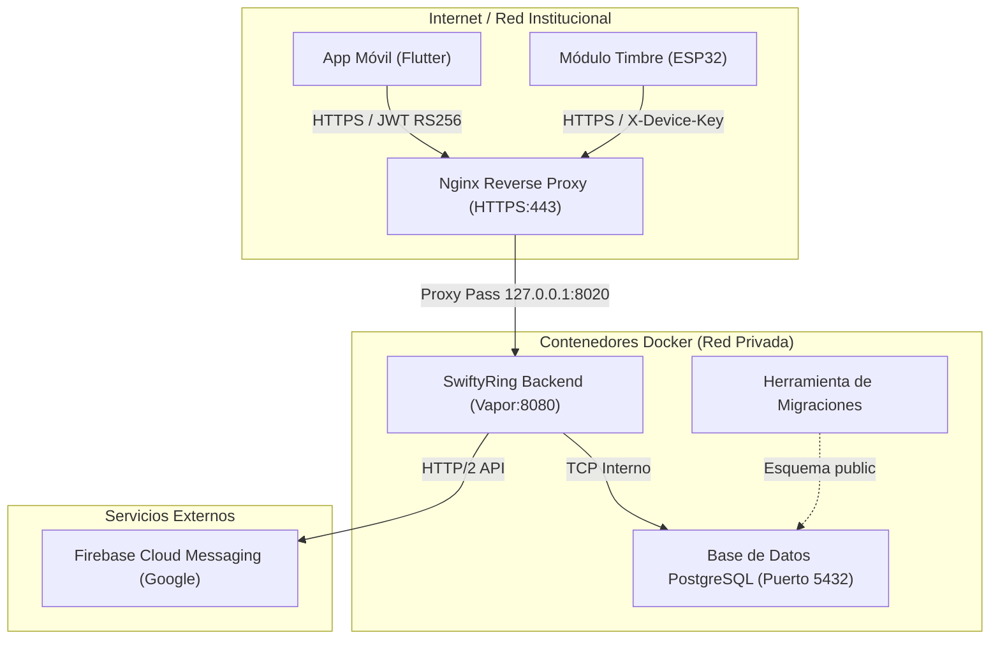

# Manual de Despliegue e Instalación · Backend SwiftyRing
**Servidor Central API — Swift / Vapor 4 con PostgreSQL en Contenedores Docker**  
*Institución Educativa Santa Sofía — Dosquebradas, Risaralda*  
*Versión del Backend: 1.0.0*

---

## 1. Arquitectura del Sistema

El backend de **SwiftyRing** está desarrollado sobre el framework **Vapor 4 (Swift)** y utiliza **PostgreSQL** como motor de base de datos relacional. El sistema opera como el servidor central de identidad, sincronización de horarios, gestión de bitácoras y despacho de notificaciones push para la aplicación móvil y el módulo físico de campana (ESP32).



---

## 2. Requisitos Previos del Servidor

Para desplegar el backend mediante Docker se requiere un servidor físico o máquina virtual con las siguientes características mínimas:

### 2.1. Requisitos de Hardware
- **Procesador:** CPU de 64 bits (x86_64 o ARM64) de al menos 2 núcleos.
- **Memoria RAM:** Mínimo 2 GB (recomendado 4 GB para compilación local si se construye la imagen en el mismo host).
- **Almacenamiento:** Mínimo 20 GB de espacio libre en disco.

### 2.2. Requisitos de Software
- **Sistema Operativo:** Distribuciones Linux recomendadas: Ubuntu Server 22.04/24.04 LTS, Debian 12, AlmaLinux 9 / Rocky Linux 9, o macOS/Windows con Docker Desktop para entornos de prueba.
- **Docker Engine:** Versión 24.0 o superior.
- **Docker Compose:** Versión v2.20 o superior (`docker compose`).
- **OpenSSL:** Utilidad de línea de comandos para la generación de claves criptográficas.
- **Git:** Para clonar y actualizar el repositorio.

Para verificar las versiones instaladas en el servidor, ejecute:
```bash
docker --version
docker compose version
openssl version
```

---

## 3. Preparación de Secretos y Llaves Criptográficas

Antes de iniciar los contenedores, es indispensable generar los certificados y claves criptográficas necesarias para la firma de tokens JWT, la autenticación del módulo físico y el envío de notificaciones.

### 3.1. Acceder al directorio del Backend
```bash
cd backend/SwiftyRing
mkdir -p keys
```

### 3.2. Generar el par de llaves asimétricas RS256 para JWT
El sistema utiliza el estándar **RS256** (criptografía asimétrica de 2048 bits). La llave privada reside únicamente en este servidor y se utiliza para firmar los tokens de acceso de la app. La llave pública verifica las firmas.

Ejecute los siguientes comandos en la terminal:
```bash
openssl genrsa -out keys/jwt_private.pem 2048
openssl rsa -in keys/jwt_private.pem -pubout -out keys/jwt_public.pem
chmod 600 keys/jwt_private.pem
```

> [!CAUTION]
> La llave `keys/jwt_private.pem` es un secreto crítico. Nunca debe compartirse, enviarse por correo ni subirse al repositorio Git.

### 3.3. Generar la clave de autenticación del Módulo Físico (`DEVICE_API_KEY`)
El módulo microcontrolador ESP32 no utiliza usuario y contraseña convencionales; se autentica mediante una clave secreta precompartida en la cabecera `X-Device-Key`.

Genere una cadena segura y aleatoria de 48 caracteres hexadecimales:
```bash
openssl rand -hex 24
```
*Copie el resultado generado; se utilizará tanto en el archivo `.env` del backend como en el firmware del ESP32.*

### 3.4. Credenciales de Firebase Cloud Messaging (FCM)
Para que los profesores reciban los avisos de clase en sus teléfonos:
1. Ingrese a la consola de [Firebase Console](https://console.firebase.google.com/).
2. Abra el proyecto de **SwiftyRing** y vaya a **Configuración del proyecto > Cuentas de servicio**.
3. Haga clic en **Generar nueva clave privada**. Se descargará un archivo JSON.
4. Renombre dicho archivo y colóquelo en la siguiente ruta:
   ```bash
   keys/fcm-cuenta-servicio.json
   ```

> [!NOTE]
> Si no dispone temporalmente del archivo de Firebase, el servidor funcionará con total normalidad: las programaciones, timbres manuales y sismos seguirán operando y registrándose en PostgreSQL; únicamente se omitirá la entrega de notificaciones a los celulares.

### 3.5. Permisos de Usuario para Contenedores (`vapor` UID 999)
La imagen Docker de Vapor corre internamente bajo un usuario sin privilegios llamado `vapor` (UID 999). Para que el contenedor pueda leer la llave privada `keys/jwt_private.pem` montada en modo de solo lectura:

```bash
# Obtener el GID de su usuario actual en el servidor
echo "SWIFTYRING_GID=$(id -g)" >> .env.production

# Asignar permisos de lectura al grupo
chmod 640 keys/jwt_private.pem
```

---

## 4. Configuración del Archivo de Variables de Entorno

Copie la plantilla de variables de entorno al archivo definitivo:

```bash
# Para despliegue en servidor de producción:
cp .env.example .env.production

# O para pruebas locales de desarrollo:
cp .env.example .env.development
```

Abra el archivo `.env.production` con su editor de texto preferido (`nano` o `vim`) y configure los valores reales:

```ini
# ==============================================================================
# CONFIGURACIÓN DE BASE DE DATOS POSTGRESQL
# ==============================================================================
DATABASE_HOST=db
DATABASE_PORT=5432
DATABASE_NAME=swiftyring
DATABASE_USERNAME=swiftyring
DATABASE_PASSWORD=contrasena_segura_de_la_base_de_datos

# En despliegue con Docker Compose de producción:
POSTGRES_DB=swiftyring
POSTGRES_USER=swiftyring
POSTGRES_PASSWORD=contrasena_segura_de_la_base_de_datos

# ==============================================================================
# FIRMA DE TOKENS JWT (RS256)
# ==============================================================================
JWT_PRIVATE_KEY_PATH=/app/keys/jwt_private.pem
JWT_PUBLIC_KEY_PATH=/app/keys/jwt_public.pem
JWT_EXPIRATION_HOURS=720

# ==============================================================================
# ADMINISTRADOR INICIAL DEL COLEGIO
# ==============================================================================
ADMIN_EMAIL=coordinacion@santasofia.edu.co
ADMIN_PASSWORD=ContrasenaInicialSegura2026*

# ==============================================================================
# MÓDULO FÍSICO ESP32 Y NOTIFICACIONES PUSH
# ==============================================================================
# La misma llave generada con openssl rand -hex 24:
DEVICE_API_KEY=tu_cadena_hexadecimal_generada_aqui

# Ruta dentro del contenedor al JSON de Firebase:
FCM_CREDENTIALS_PATH=/app/keys/fcm-cuenta-servicio.json

# Nivel de detalle de bitácoras (debug | info | warning | error)
LOG_LEVEL=info
```

---

## 5. Despliegue con Docker Compose Paso a Paso

El repositorio provee dos configuraciones según el caso de uso:
- `docker-compose.prod.yml`: Configuración blindada para servidor institucional (PostgreSQL privado sin exponer puertos, bind local a puerto `8020`, healthcheck de base de datos).
- `docker-compose.yml`: Configuración para pruebas rápidas de laboratorio o desarrollo local (expone puerto 8080 y 5432).

A continuación se detalla el despliegue con la configuración de **Producción** (`docker-compose.prod.yml`).

### Paso 1: Construir la imagen Docker de SwiftyRing
El Dockerfile utiliza una compilación multi-etapa (*multi-stage build*) con Swift optimizado para producción en Debian/Ubuntu:
```bash
docker compose -f docker-compose.prod.yml build
```
*(Este proceso compila el código fuente en Swift y puede tomar algunos minutos la primera vez).*

### Paso 2: Iniciar la Base de Datos PostgreSQL y verificar su estado
Inicie el contenedor de base de datos en segundo plano:
```bash
docker compose -f docker-compose.prod.yml up -d db
```

Verifique que el servicio esté listo y respondiendo al *healthcheck*:
```bash
docker compose -f docker-compose.prod.yml ps
```
*Debe figurar con estado `healthy`.*

### Paso 3: Ejecutar las Migraciones del Esquema Relacional
Las migraciones crean automáticamente las 17 tablas del esquema `public`, índices relacionales y el usuario administrador inicial declarado en el archivo de entorno:
```bash
docker compose -f docker-compose.prod.yml --profile tools run --rm migrate
```
*Mensaje esperado en consola:*
```
[notice] [Migration] Creating schema and tables...
[notice] [Migration] Seeding initial admin user: coordinacion@santasofia.edu.co
[notice] [Migration] Successfully applied all migrations.
```

### Paso 4: Iniciar el Servicio API de SwiftyRing
Levante todos los servicios en segundo plano:
```bash
docker compose -f docker-compose.prod.yml up -d
```

### Paso 5: Monitorear la salida de registros (Logs)
Compruebe que el servidor esté activo y escuchando peticiones:
```bash
docker compose -f docker-compose.prod.yml logs -f app
```
*Deberá observar una salida similar a:*
```
[notice] Server starting on http://0.0.0.0:8080
[notice] SwiftyRing Core & TimbreEscolar Module initialized.
```
*(Presione `Ctrl + C` para salir del visor de logs; los contenedores continúan activos).*

---

## 6. Configuración de Proxy Inverso Nginx y Certificado SSL (HTTPS)

En entornos institucionales y de producción, la aplicación móvil y el módulo ESP32 deben comunicarse obligatoriamente mediante **HTTPS (puerto 443)** con cifrado TLS para proteger las contraseñas y las peticiones del hardware.

El contenedor de producción publica el servicio localmente en `127.0.0.1:8020`. Nginx recibe las conexiones de internet y las transfiere a Vapor.

### 6.1. Crear archivo de configuración en Nginx
Cree o edite el archivo `/etc/nginx/conf.d/swiftyring.conf`:

```nginx
server {
    listen 80;
    server_name swiftyring.santasofia.edu.co;

    # Redirección obligatoria a HTTPS
    return 301 https://$host$request_uri;
}

server {
    listen 443 ssl http2;
    server_name swiftyring.santasofia.edu.co;

    ssl_certificate /etc/letsencrypt/live/swiftyring.santasofia.edu.co/fullchain.pem;
    ssl_certificate_key /etc/letsencrypt/live/swiftyring.santasofia.edu.co/privkey.pem;

    ssl_protocols TLSv1.2 TLSv1.3;
    ssl_ciphers HIGH:!aNULL:!MD5;

    client_max_body_size 16M;

    location / {
        proxy_pass http://127.0.0.1:8020;
        proxy_http_version 1.1;

        proxy_set_header Upgrade $http_upgrade;
        proxy_set_header Connection "upgrade";
        proxy_set_header Host $host;
        proxy_set_header X-Real-IP $remote_addr;
        proxy_set_header X-Forwarded-For $proxy_add_x_forwarded_for;
        proxy_set_header X-Forwarded-Proto $scheme;

        proxy_connect_timeout 60s;
        proxy_send_timeout 60s;
        proxy_read_timeout 60s;
    }
}
```

### 6.2. Generar el Certificado SSL Gratuito con Certbot
```bash
sudo certbot --nginx -d swiftyring.santasofia.edu.co
sudo nginx -t && sudo systemctl reload nginx
```

---

## 7. Mantenimiento, Copias de Respaldo y Diagnóstico

### 7.1. Comandos de Operación Rápida
| Acción | Comando |
|---|---|
| **Ver estado de contenedores** | `docker compose -f docker-compose.prod.yml ps` |
| **Ver logs en tiempo real** | `docker compose -f docker-compose.prod.yml logs -f app` |
| **Reiniciar el servidor backend** | `docker compose -f docker-compose.prod.yml restart app` |
| **Detener todos los servicios** | `docker compose -f docker-compose.prod.yml down` |
| **Actualizar el código y recompilar** | `git pull && docker compose -f docker-compose.prod.yml build app` |

### 7.2. Copia de Respaldo (Backup) de la Base de Datos
Para generar un volcado íntegro de la base de datos sin detener los servicios:
```bash
docker compose -f docker-compose.prod.yml exec -T db pg_dump -U swiftyring swiftyring > "backup_swiftyring_$(date +%Y%m%d_%H%M%S).sql"
```

### 7.3. Restauración de una Copia de Respaldo
```bash
cat backup_swiftyring_20261022.sql | docker compose -f docker-compose.prod.yml exec -T db psql -U swiftyring swiftyring
```

### 7.4. Reversión de Migraciones
Si necesita revertir la última migración aplicada:
```bash
docker compose -f docker-compose.prod.yml --profile tools run --rm revert
```

---

## 8. Diagnóstico de Problemas Comunes

### Error: `Cannot open file keys/jwt_private.pem: Permission denied`
**Causa:** El contenedor corre bajo el usuario `vapor` (UID 999) y la clave privada pertenece a `root` o a otro usuario sin permiso de lectura en el grupo.  
**Solución:**
```bash
# Asignar el grupo correcto y permisos 640
chown -R $(id -u):$(id -g) keys/
chmod 640 keys/jwt_private.pem
chmod 644 keys/jwt_public.pem
# Reiniciar el contenedor
docker compose -f docker-compose.prod.yml restart app
```

### Error: `PostgreSQL connection refused` al arrancar
**Causa:** El contenedor `app` intentó conectarse antes de que la base de datos estuviera inicializada.  
**Solución:** El archivo `docker-compose.prod.yml` incluye una condición de salud `depends_on: db: condition: service_healthy`. Verifique los registros del servicio `db`:
```bash
docker compose -f docker-compose.prod.yml logs db
```

### El módulo ESP32 recibe error HTTP 503 o 401
**Causa:** La variable `DEVICE_API_KEY` en `.env.production` no coincide exactamente con el valor configurado en el `config.h` del microcontrolador.  
**Solución:** Verifique que ambos archivos tengan la misma cadena y reinicie el servicio `app`.
