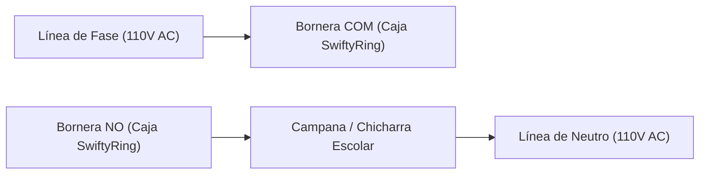
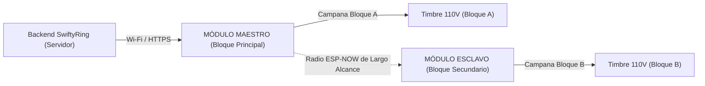

# Manual de Instalación y Conexión · Módulo Físico SwiftyRing
**Unidad de Control Inteligente de Timbre Escolar y Alerta Sísmica (ESP32)**  
*Institución Educativa Santa Sofía — Dosquebradas, Risaralda*  
*Versión de Firmware: ESP-IDF v6.0.2 / Arduino v1.0*

---

## 1. Descripción del Módulo Físico

El módulo físico de **SwiftyRing** se entrega **completamente preensamblado dentro de una caja protectora (chasis impreso en 3D)**. La circuitería interna, el microcontrolador ESP32, el reloj de tiempo real de alta precisión (RTC DS3231), el sensor acelerómetro sísmico (MPU-6050), el relé de conmutación y la pantalla OLED frontal vienen instalados y cableados de fábrica.

El instalador o técnico encargado únicamente debe realizar:
1. La fijación mecánica de la caja a una pared estructural.
2. La conexión de la alimentación eléctrica.
3. La conexión de la bornera de salida hacia la campana/timbre existente del colegio.
4. La configuración inicial de red Wi-Fi y enlace con el servidor backend.

```
                  VISTA FRONTAL DE LA CAJA
        ┌───────────────────────────────────────────────┐
        │   SwiftyRing · Sistema de Timbre Inteligente  │
        │  ┌─────────────────────────────────────────┐  │
        │  │ 10:14:32 AM         Wi-Fi: OK (192.168) │  │  ← Pantalla OLED
        │  │ PRÓXIMO TIMBRE: 10:15:00 AM             │  │    SH1106 1.3"
        │  │ RESTANTE: 00 min 28 s                   │  │
        │  └─────────────────────────────────────────┘  │
        │                                               │
        │      (🔴)                    [ BOTÓN TIMBRE ] │
        │   LED Alerta                    Toque Manual  │
        └───────────────────────────────────────────────┘
```

---

## 2. Salidas y Conexiones Externas de la Caja

En los laterales o parte inferior de la caja protectora se disponen las siguientes salidas y bornes de conexión rápida:

```
          CONEXIONES EXTERNAS DE LA CAJA SWIFTYRING
 ┌─────────────────────────────────────────────────────────────┐
 │                                                             │
 │  [ USB-C / DC 5V ]  [ BORNERA RELÉ (110V) ]  [ BOTÓN EXT ]  │
 │     Alimentación       Fase Campana Escolar     (Opcional)  │
 └─────────────────────────────────────────────────────────────┘
```

### 2.1. Entrada de Alimentación Eléctrica
- **Tipo de conector:** Puerto USB-C o conector Jack DC 5V (según la versión de chasis).
- **Especificaciones:** 5V DC, mínimo 2A.
- **Recomendación institucional:** Conectar a un adaptador de pared certificado conectado a una toma de corriente respaldada por la UPS del colegio o un regulador de voltaje para garantizar operación ininterrumpida ante apagones.

### 2.2. Bornera de Salida hacia la Campana Escolar (Contactos de Relé)
La caja dispone de una bornera de dos o tres polos (Normalmente Abierto **NO** y Común **COM**), que actúa como un interruptor eléctrico automático:
- **Tensión soportada:** 110V AC – 240V AC / 10A (o 12V DC en campanas electrónicas).
- **Modo de conexión:** Se conecta **en serie** con la fase de la campana, sustituyendo o colocándose en paralelo con el pulsador tradicional de la secretaría.



> [!CAUTION]
> **PELIGRO DE DESCARGA ELÉCTRICA:**  
> La bornera del relé conmuta la línea de 110V/220V de la red comercial. **Baje el disyuntor/breaker general del circuito de timbres en el tablero eléctrico** antes de pelar o atornillar los cables en la bornera de la caja.

### 2.3. Conector de Botón Manual Externo (Opcional)
Si la institución desea conservar un pulsador físico remoto (por ejemplo, en el escritorio de la rectoría o en la portería):
- La caja dispone de una bornera de dos pines de baja tensión (señal a tierra GND y entrada digital).
- Permite conectar un pulsador de contacto momentáneo normalmente abierto.

---

## 3. Instalación Mecánica y Ubicación de la Caja

El sensor acelerómetro sísmico **MPU-6050** se encuentra integrado rígidamente dentro de la caja. Para que pueda detectar de manera fidedigna los movimientos telúricos y discriminar vibraciones accidentales:

1. **Superficie de Montaje:**  
   Fije la caja a una **pared o columna estructural de concreto/ladrillo**. **NO** la instale sobre divisiones de yeso cartón (drywall), madera, puertas ni sobre mesas, ya que un portazo o el apoyo de objetos sobre la mesa generaría falsas alarmas.
2. **Nivelación:**  
   Instale la caja en posición horizontal nivelada, asegurando que los tornillos queden firmemente apretados para transmitir las ondas del suelo directamente al chasis.
3. **Visibilidad:**  
   Ubique la caja a la altura de la vista (aprox. 1.60 m del suelo) en un área accesible (Secretaría, Coordinación o Rectoría) para que el personal pueda consultar la pantalla OLED y accionar el botón de toque manual si es necesario.

---

## 4. Configuración y Flasheo del Firmware (ESP-IDF)

El módulo se entrega con el firmware ya instalado. Si en algún momento se requiere actualizar el código, cambiar de red Wi-Fi o modificar la clave de dispositivo, siga el procedimiento oficial con **ESP-IDF v6.0+**.

### 4.1. Activar el Entorno de Desarrollo ESP-IDF
Abra una terminal y active el entorno oficial:
```bash
. ~/.espressif/tools/activate_idf_v6.0.2.sh
```

### 4.2. Configuración de Parámetros de Red y Servidor
1. Ingrese a la carpeta del firmware ESP-IDF:
   ```bash
   cd firmware/timbre-idf/main
   ```
2. Copie la plantilla de configuración si no existe:
   ```bash
   cp config.example.h config.h
   ```
3. Abra `config.h` y configure los datos institucionales:
   ```c
   // Red Wi-Fi del Colegio
   #define WIFI_SSID       "SantaSofia_Docentes"
   #define WIFI_PASSWORD   "ClaveWifiColegio2026"

   // URL Base de la API (Servidor SwiftyRing con HTTPS)
   #define API_BASE        "https://swiftyring.santasofia.edu.co/api"

   // Llave secreta del hardware (idéntica a DEVICE_API_KEY en el .env del Backend)
   #define DEVICE_API_KEY  "dev-esp32-timbre-2026"

   // Clave de cifrado de radio para enlace entre módulos (ESP-NOW)
   #define ENLACE_CLAVE    "clave-secreta-institucional-espnow"
   ```

### 4.3. Selección de la Placa Microcontroladora
El firmware autodetecta la distribución de pines según el microcontrolador:
- Para **ESP32-S3:**
  ```bash
  cd firmware/timbre-idf && idf.py set-target esp32s3
  ```
- Para **ESP32-WROOM tradicional:**
  ```bash
  cd firmware/timbre-idf && idf.py set-target esp32
  ```

### 4.4. Compilación y Flasheo por Cable USB
1. Conecte la caja al computador mediante un cable USB de datos.
2. Identifique el puerto serial asignado:
   - En macOS: `ls /dev/cu.usbserial*` o `/dev/cu.wchusbserial*`
   - En Linux: `ls /dev/ttyUSB*` o `/dev/ttyACM*`
3. Si es la primera vez que se instala en el chip, borre la memoria flash:
   ```bash
   idf.py -p /dev/cu.usbserial-0001 erase-flash
   ```
4. Compile y flashee el firmware:
   ```bash
   idf.py -p /dev/cu.usbserial-0001 flash monitor
   ```
5. Para salir del monitor serie presione: `Ctrl + ]`.

---

## 5. Modo de Operación Multi-Módulo (Maestro y Esclavo)

Si la institución cuenta con dos bloques o sedes separadas (ej. Bloque de Primaria y Bloque de Bachillerato) donde no llega el cableado de la campana:



- **Módulo Maestro (`ROL_ESCLAVO = 0`):** Conectado al Wi-Fi institucional, consulta el horario al backend y retransmite vía radio propia (ESP-NOW) la orden de sincronización.
- **Módulo Esclavo (`ROL_ESCLAVO = 1`):** No requiere internet ni credenciales Wi-Fi; escucha las tramas cifradas del maestro por radio y hace sonar la campana de su propio edificio al mismo milisegundo.

Para compilar el rol de esclavo:
```bash
idf.py -B build-esclavo -DESCLAVO=1 build flash monitor
```

---

## 6. Futuro Asistente de Configuración (Setup Wizard Web)

Para facilitar aún más la puesta en marcha sin necesidad de instalar entornos de programación ni cables USB, el sistema está preparado para soportar un **Portal Cautivo Web**:

```
      FLUJO DEL ASISTENTE SIMPLIFICADO (SETUP WIZARD)
 ┌─────────────────────────────────────────────────────────────┐
 │ 1. Encender el módulo manteniendo pulsado el botón 5 seg.   │
 │ 2. Conectarse desde el celular a la red: SwiftyRing-Config  │
 │ 3. El navegador abrirá automáticamente http://192.168.4.1   │
 │ 4. Seleccionar la red Wi-Fi escolar e ingresar la clave.    │
 │ 5. Pegar la DEVICE_API_KEY y guardar.                       │
 │ 6. El módulo se reinicia solo y entra en modo operativo.    │
 └─────────────────────────────────────────────────────────────┘
```

---

## 7. Verificación Operativa y Pruebas en Vivo

Una vez conectada y energizada la caja:

### 7.1. Lectura de la Pantalla OLED
- **Línea 1:** Hora actual y estado de conectividad Wi-Fi (muestra la dirección IP asignada, ej. `192.168.1.145`).
- **Línea 2:** Próximo toque programado según el horario escolar.
- **Línea 3:** Minutos y segundos restantes para el timbre.
- **Estado OFFLINE:** Si no hay Wi-Fi, la pantalla mostrará `[OFFLINE]`; el timbre continuará sonando a la hora fijada gracias al chip RTC DS3231.

### 7.2. Prueba de Toque Manual Físico
1. Pulse el botón metálico situado en la parte frontal de la caja.
2. El relé debe conmutar inmediatamente, la campana sonará durante 5 segundos y la pantalla mostrará: `TIMBRE ACTIVO (MANUAL)`.
3. El evento se registrará en la memoria y se transmitirá al backend.

### 7.3. Prueba de Toque Remoto desde la Aplicación
1. Abra la app de SwiftyRing con rol Administrador.
2. Presione el botón central de timbre manual.
3. La caja recibirá la orden en menos de 2 segundos y activará la campana.

### 7.4. Verificación del Sensor Sísmico
1. Golpear la mesa **no** debe activar la alarma (el algoritmo requiere vibración continua en bandas sísmicas, evitando falsos positivos).
2. Ante una sacudida lateral sostenida de la caja durante más de 2 segundos, el sistema disparará la **Alarma de Evacuación** (toques continuos o intermitentes rápidos), activará el LED destellante frontal y reportará de inmediato la alerta crítica al servidor y a los teléfonos celulares.
