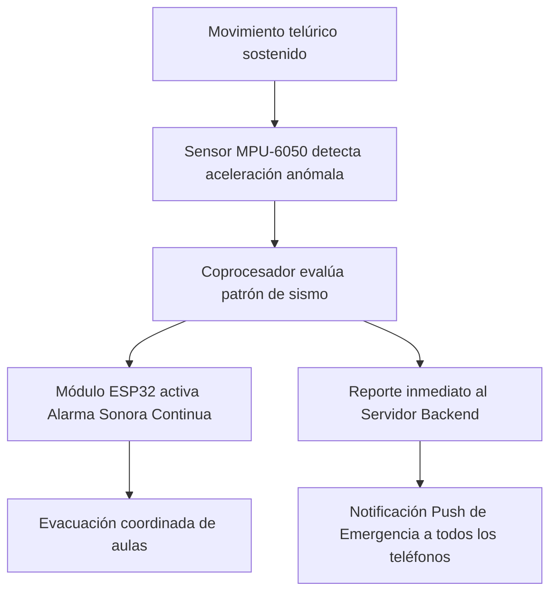

# Manual de Usuario · Aplicación Móvil SwiftyRing
**Sistema de Timbre Escolar Inteligente**  
*Institución Educativa Santa Sofía — Dosquebradas, Risaralda*  
*Versión de la aplicación: 1.0.0+1*

---

## 1. Introducción y Acceso al Sistema

La aplicación móvil de **SwiftyRing** es la interfaz centralizada para la consulta de horarios, notificación temprana de clases, control manual del timbre escolar y recepción de alertas tempranas de emergencia sísmica.

### 1.1. Requisitos del Dispositivo
- **Sistema Operativo:** Android 8.0 (Oreo) o superior / iOS 14.0 o superior.
- **Conectividad:** Conexión a la red Wi-Fi institucional o datos móviles para sincronización en tiempo real.
- **Permisos requeridos:** Permiso de notificaciones push (imprescindible para los avisos de próxima clase y alertas de evacuación).

---

### 1.2. Inicio de Sesión y Configuración de Conexión
Al abrir la aplicación por primera vez se presenta la pantalla de autenticación institucional:

1. **Credenciales de Acceso:**
   - Ingrese su **Correo Electrónico Institucional** (ej. `profesor@santasofia.edu.co`).
   - Ingrese su **Contraseña**.
2. **Selector de Servidor (Opcional / Red Local):**
   - Si la aplicación no detecta automáticamente el servidor o se encuentra en pruebas de red local, toque el ícono de engranaje o enlace de **Ajustes de Servidor** en la esquina superior.
   - Verifique que la URL apunte al servidor central del colegio (ej. `https://swiftyring.swiftydevs.dev/api` o IP institucional).
3. Presione el botón **Iniciar Sesión**.

> [!NOTE]
> La aplicación utiliza tokens de autenticación segura (JWT RS256). Su sesión permanecerá activa de manera segura sin necesidad de volver a ingresar sus credenciales en cada inicio.

---

## 2. Guía para Docentes (Perfil Profesor)

Cuando un docente inicia sesión, la aplicación se abre directamente en la vista **Mi Horario**, diseñada para ofrecer una experiencia rápida y sin distracciones durante la jornada laboral.

```
┌────────────────────────────────────────────────────────┐
│  Profesor: Lic. Carlos Gómez                           │
│  [ Rol: Profesor ]                                     │
├────────────────────────────────────────────────────────┤
│  ┌──────────────────────────────────────────────────┐  │
│  │  PRÓXIMO TIMBRE                     10:15 AM     │  │
│  │  Tiempo restante:                    12 min 34 s │  │
│  │  Motivo: Fin de Bloque 2 · Salida a Descanso     │  │
│  └──────────────────────────────────────────────────┘  │
│                                                        │
│  EN CURSO: Matemáticas · Grado 9-A (Aula 204)          │
│  A CONTINUACIÓN: Descanso General (Patio Principal)    │
│                                                        │
│  [ Ver horario semanal completo ]                      │
└────────────────────────────────────────────────────────┘
```

### 2.1. Tarjeta "Próximo Timbre" y Cuenta Regresiva
En la parte superior de la pantalla se ubica la tarjeta principal en color amarillo/dorado institucional:
- **Hora exacta del toque:** Indica a qué hora sonará la campana física (ej. `10:15 AM`).
- **Cuenta regresiva en tiempo real:** Muestra los minutos y segundos exactos que faltan para el timbre.
- **Sincronización:** La hora de referencia proviene directamente del servidor y del reloj de alta precisión del módulo físico, evitando desfases provocados por la hora de su teléfono celular.

### 2.2. Resumen del Día: Clase en Curso y Próxima Clase
Debajo de la tarjeta de próximo timbre se despliega su ubicación académica actual:
- **Clase en curso:** Muestra la asignatura, grado asignado, aula de clase y rango horario actual (ej. `Matemáticas · Grado 9-A · Aula 204`).
- **Próxima clase:** Informa la materia y el salón hacia donde debe desplazarse una vez suene la campana.

### 2.3. Consulta del Horario Semanal Completo
1. En la parte inferior de la pantalla principal, presione el botón **Ver horario completo**.
2. Podrá desplazarse por una matriz organizada por días de la semana (Lunes a Viernes) y bloques horarios.
3. Cada bloque detalla: hora de inicio, hora de finalización, materia, grupo y salón correspondiente.

### 2.4. Notificaciones Push Automáticas
El docente no necesita mantener la aplicación abierta de forma continua. El sistema enviará notificaciones automáticas a su pantalla de bloqueo:
- **Aviso de 10 minutos:** Notificación informativa previa al cambio de clase para iniciar el cierre pedagógico.
- **Aviso de 5 minutos:** Notificación de preparación para cambio de aula o salida a descanso.
- **Alerta de Sismo / Evacuación:** Notificación prioritaria con sonido estridente ante la activación de la alarma sísmica del módulo físico.

### 2.5. Ajustes del Perfil Docente (*Mis Ajustes*)
Desde la barra de navegación o menú lateral puede acceder a **Mis Ajustes**:
- Visualización de datos registrados (Nombre, correo institucional y documento).
- Estado de recepción de notificaciones push en el dispositivo.
- Botón **Cerrar Sesión**.

> [!TIP]
> Si la directiva escolar informa un cambio repentino de horario o cambio de aula, realice el gesto de **arrastrar la pantalla hacia abajo (pull-to-refresh)** en la vista de *Mi Horario* para actualizar inmediatamente toda su programación.

---

## 3. Guía para Administradores y Operadores

Los usuarios con rol de **Administrador** o **Coordinador/Operador** tienen el control operativo y la gestión de la infraestructura del timbre escolar.

### 3.1. Pantalla "Control de Timbres" (Vista Principal)
Al ingresar, el administrador visualiza la programación del día vigente:
- **Encabezado de Estado:** Señala si el día opera bajo la *Programación habitual* o bajo un *Horario especial* (ej. Acto cívico, horario reducido).
- **Selector de Modo:** Permite alternar la vista entre el horario regular y los horarios especiales.
- **Cronograma de Timbres del Día:** Listado en orden cronológico con cada toque, tipo de evento (entrada, cambio de hora, receso, salida) y duración asignada al relé físico (en segundos).

```
┌────────────────────────────────────────────────────────┐
│  SwiftyRing · Control de Timbres                       │
│  Programación diaria vigente · Sede Central            │
│  [ NORMAL ]  [ ESPECIAL ]                              │
├────────────────────────────────────────────────────────┤
│  06:45 AM  Entrada Jornada Mañana        (Toque 5 s)   │
│  07:40 AM  Cambio de Bloque 1 a 2        (Toque 3 s)   │
│  08:35 AM  Cambio de Bloque 2 a 3        (Toque 3 s)   │
│  09:30 AM  Salida a Descanso General     (Toque 5 s)   │
│                                                        │
│                       [ 🔔 ]                           │
│                TIMBRE MANUAL INMEDIATO                 │
└────────────────────────────────────────────────────────┘
```

---

### 3.2. Accionamiento Manual del Timbre (Botón Central)
Para situaciones imprevistas, adelanto de descansos o emergencias locales:
1. En la parte inferior del *Control de Timbres*, localice el **botón circular central con ícono de campana**.
2. Al presionarlo, la aplicación enviará una orden prioritaria e inmediata al backend, la cual es captada por el microcontrolador ESP32 en menos de 2 segundos.
3. El relé de la campana se accionará físicamente.
4. Toda activación manual queda registrada con el nombre del usuario y la hora exacta en la bitácora de auditoría.

> [!WARNING]
> Utilice el accionamiento manual de forma responsable. La orden viaja directamente al circuito eléctrico de la campana institucional y queda registrada con su nombre en el historial de eventos.

---

### 3.3. Configuración y Edición de Timbres Habituales
Para modificar la rutina diaria de la institución:
1. En la lista de timbres del día, pulse el ícono de **Lápiz / Editar** junto al timbre que desea ajustar, o pulse el botón flotante **"+"** para agregar un nuevo toque.
2. Complete o modifique los campos del formulario:
   - **Hora del Timbre:** Seleccione la hora y minuto exactos en formato militar o 12 horas.
   - **Descripción / Etiqueta:** Motivo del timbre (ej. *Entrada Bachillerato*, *Cambio de Hora*, *Fin de Jornada*).
   - **Duración del Toque (segundos):** Tiempo que el relé permanecerá cerrado activando la campana (recomendado: 3 segundos para cambio de hora; 5 a 6 segundos para entradas y salidas).
   - **Días de la Semana:** Marque los días en que debe sonar (Lunes a Viernes).
   - **Estado Activo:** Interruptor para encender o apagar el timbre temporalmente sin eliminarlo.
3. Presione **Guardar Cambios**. La nueva programación se sincroniza de inmediato con la memoria flash del módulo físico.

---

### 3.4. Creación y Activación de Horarios Especiales
Los horarios especiales reemplazan la programación habitual en días específicos (actos culturales, jornadas pedagógicas, pruebas Saber, horarios reducidos por calor o celebraciones):
1. En el menú superior o selector de modo, ingrese a **Especiales**.
2. Pulse **Nuevo Horario Especial**.
3. Ingrese el **Nombre del Evento** (ej. *Acto Cívico 20 de Julio*) y la **Fecha de Aplicación**.
4. Defina la lista personalizada de timbres para esa jornada con sus horas y duraciones.
5. Guarde la configuración.
6. El sistema activará automáticamente este horario durante el día programado y restablecerá la rutina habitual al día siguiente sin intervención manual.

---

### 3.5. Directorio Docente y Asignación Académica
Para garantizar que los profesores reciban sus notificaciones de aula correctas:
1. Navegue a la sección **Docentes**.
2. **Alta de Docente:** Permite registrar nuevos profesores asociando su nombre completo, correo institucional y documento de identidad.
3. **Asignación Horaria:** Ingrese a la ficha del docente y asigne las horas semanales:
   - Seleccione el Día (Lunes a Viernes).
   - Seleccione la Hora / Bloque.
   - Indique la Asignatura y el Grupo/Aula asignada.
4. Los cambios se reflejarán instantáneamente en la pantalla de *Mi Horario* del docente asignado.

---

### 3.6. Historial y Bitácora de Auditoría
La sección **Historial** recopila un registro inmutable de todas las activaciones ocurridas:
- **Toques Programados:** Activaciones automáticas ejecutadas por el reloj interno del módulo.
- **Toques Manuales por App:** Registra quién presionó el botón en la aplicación y a qué hora.
- **Toques Manuales por Botón Físico:** Registra si alguien pulsó el interruptor manual instalado junto a la caja.
- **Alertas Sísmicas:** Registra la detección inercial por parte del sensor MPU-6050, el nivel de aceleración detectado y la duración de la alarma.

---

### 3.7. Panel de Configuración y Diagnóstico del Hardware (*Ajustes*)
Accesible únicamente para el Administrador:
- **Estado del Módulo Físico (ESP32):**
  - Indicador de estado: *En Línea* (verde) o *Desconectado* (rojo).
  - Dirección IP asignada al módulo en la red local.
  - Marca de tiempo del último reporte o sincronización (*heartbeat*).
  - Versión del firmware instalado.
- **Calibración del Sensor Sísmico:**
  - Ajuste de umbral de sensibilidad de detección inercial (para evitar falsos positivos por portazos o vibraciones de tráfico pesado).
  - Tiempo de sostenimiento requerido para disparar la alerta de evacuación.
- **Gestión de Usuarios:** Creación, edición de roles y reseteo de contraseñas.

---

## 4. Respuesta ante Eventos Sísmicos

SwiftyRing incorpora un sistema de seguridad para protección civil escolar mediante el sensor acelerómetro MPU-6050:



1. **Alerta Física:** El módulo físico hace sonar la campana en un patrón continuo o intermitente característico de evacuación de emergencia, con independencia de si hay internet o energía comercial (si cuenta con respaldo UPS).
2. **Alerta en la App:** Todos los dispositivos de la comunidad docente y directiva recibirán una notificación emergente con sonido de alerta máxima indicando:  
   **"¡ALERTA SÍSMICA DETECTADA! INICIE PROTOCOLO DE EVACUACIÓN"**.
3. **Procedimiento:** Todo el personal debe suspender actividades de inmediato y guiar a los estudiantes hacia los puntos de encuentro seguros establecidos por la institución.

---

## 5. Preguntas Frecuentes y Solución de Problemas

### ¿Qué sucede si la institución se queda sin servicio de Internet?
El módulo físico de SwiftyRing cuenta con memoria flash interna autónoma y un reloj de tiempo real (RTC DS3231) con respaldo por batería de litio. **La campana continuará sonando puntualmente a las horas programadas aunque no haya conexión a Internet.** En la app, la pantalla mostrará una advertencia de modo sin conexión y los eventos ocurridos se sincronizarán en cuanto retorne la red.

### No recibo las notificaciones de próxima clase en mi teléfono.
1. Abra la configuración de su teléfono móvil, busque la aplicación **SwiftyRing** y verifique que las **Notificaciones** se encuentren habilitadas.
2. En teléfonos con sistemas agresivos de ahorro de batería (Xiaomi, Huawei, Samsung), asegúrese de desactivar la optimización de batería para SwiftyRing a fin de permitir la recepción en segundo plano.
3. Verifique que su cuenta de usuario tenga asignado el rol de **Profesor** y cuente con asignaciones horarias activas para el día corriente.

### Presiono el botón de timbre manual pero la campana no suena.
1. Revise en la pantalla de *Ajustes* si el módulo ESP32 figura con estado **En Línea**.
2. Si el módulo figura *Desconectado*, verifique que la caja física esté encendida y conectada a la red Wi-Fi escolar.
3. Verifique que el interruptor eléctrico del circuito de campanas en el tablero general de la institución esté activo.
